# Activity Diagrams

This document holds the activity diagram of every use case described in
[use-cases.md](use-cases.md). **An activity diagram** shows the flow of a
use case as a flowchart, with one swimlane per actor/component involved
(`Customer`, `Admin`, `System`, ...). Every diagram has exactly one start
node and one end node; every branch, including every error outcome,
eventually merges back into a single final step before that end, so no
alternative flow is a dead end.

The activity diagram is the better starting point for explaining a flow to
a non-technical audience; the [sequence diagram](sequence-diagrams.md) is
the one to open when discussing the actual implementation or writing a test
for it.

## UC1 — Register

Use case: [UC1 — Register](use-cases.md#uc1--register-)

The diagram reduces the whole use case to one decision the System makes
right after the form is submitted: is the e-mail already taken? The `no`
branch is the common path — hashing the password, creating the account and
issuing a token all happen before control returns to the customer; the
`yes` branch only ever produces an error. Both branches converge on the
same final "see result" step, so the customer always gets one unambiguous
outcome regardless of which path was taken.

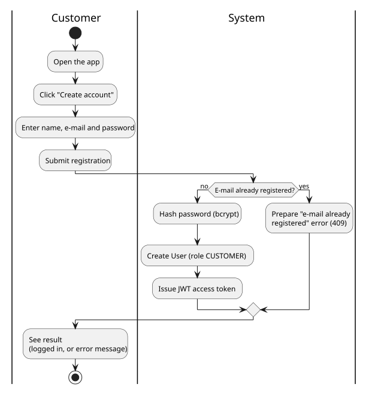

*Diagram source: [diagrams/activity-register.puml](diagrams/activity-register.puml).*

## UC2 — Log in

Use case: [UC2 — Log in](use-cases.md#uc2--log-in-)

Structurally this mirrors registration, but with a single check instead of
two possible causes of failure: does the submitted e-mail/password pair
match an existing account? Only the System swimlane branches — the
customer's own steps (enter credentials, submit) are identical regardless
of the outcome — and both branches converge on the same final step before
the diagram ends.

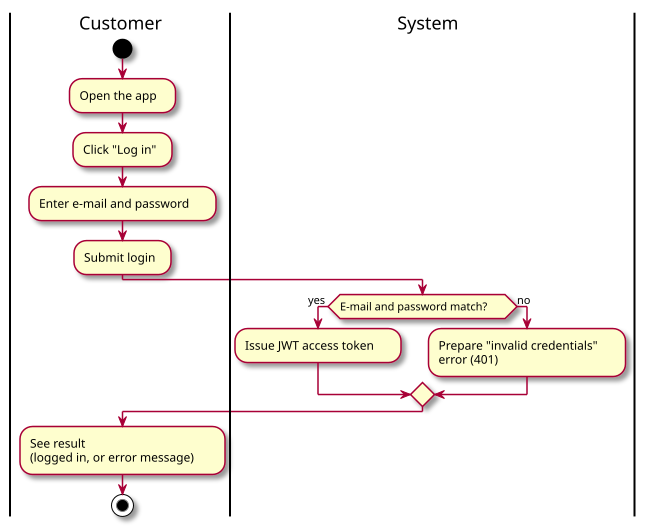

*Diagram source: [diagrams/activity-login.puml](diagrams/activity-login.puml).*

## UC3 — Browse & filter cars

Use case: [UC3 — Browse & filter cars](use-cases.md#uc3--browse--filter-cars-)

The System always returns the complete, unfiltered fleet first, so the
customer never faces an empty screen while deciding whether to filter at
all; the single `if` in the System swimlane only runs once a filter is
actively chosen, and its result simply replaces the car grid already on
screen rather than starting a new flow.

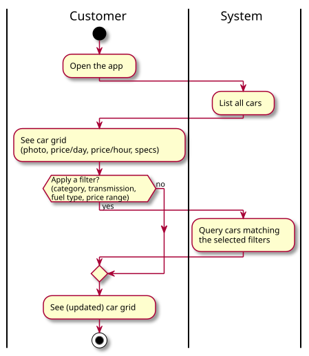

*Diagram source: [diagrams/activity-browse-cars.puml](diagrams/activity-browse-cars.puml).*

## UC4 — Create reservation

Use case: [UC4 — Create reservation](use-cases.md#uc4--create-reservation-)

This is the most involved flow in the system: it nests three independent
decisions — is the customer logged in, do the chosen dates satisfy the
opening-hours/return-after-pickup rule, and is the car available — and the
availability check (UC4a) deliberately runs *twice*: once live while the
dates are being picked, purely to inform the customer, and once more,
authoritatively, the instant the reservation is submitted, because the
first result can go stale while the customer is still choosing a payment
method. Every branch, including both distinct "slot taken" outcomes, still
merges into the same single final "see result" step.

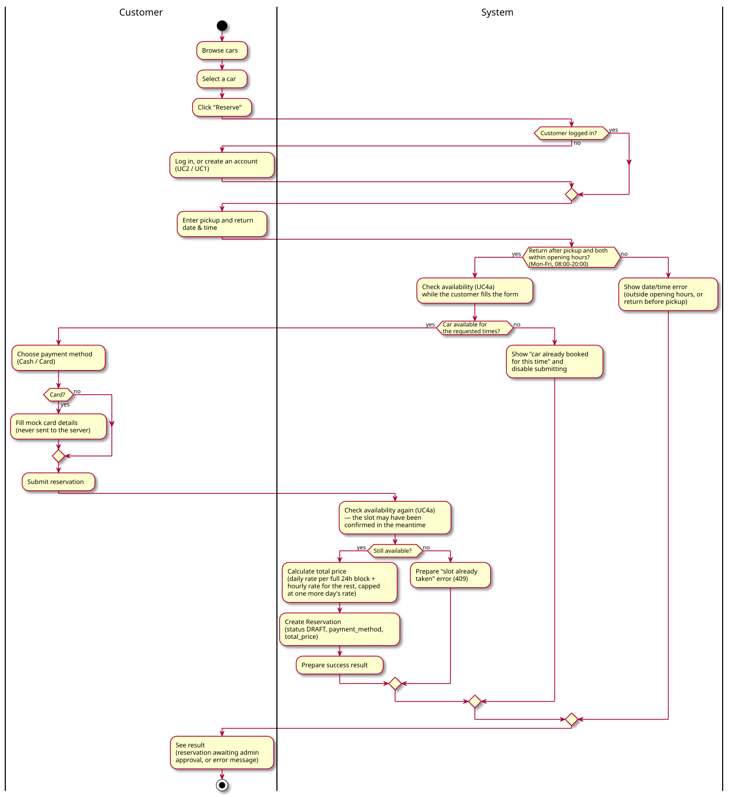

*Diagram source: [diagrams/activity-make-reservation.puml](diagrams/activity-make-reservation.puml).*

## UC4a — Check availability

Use case: [UC4a — Check availability](use-cases.md#uc4a--check-availability--include-part-of-uc4-and-uc8)

Because this use case is only ever triggered by another one (UC4 or UC8),
its first swimlane belongs to the *caller* ("Customer / Admin") rather than
to an actor acting on its own — and the System lane reduces to a single
comparison: does any `CONFIRMED` reservation for this car overlap the
requested date range? `DRAFT` and `CANCELLED` reservations are deliberately
excluded from the check, since neither of them actually blocks the slot.

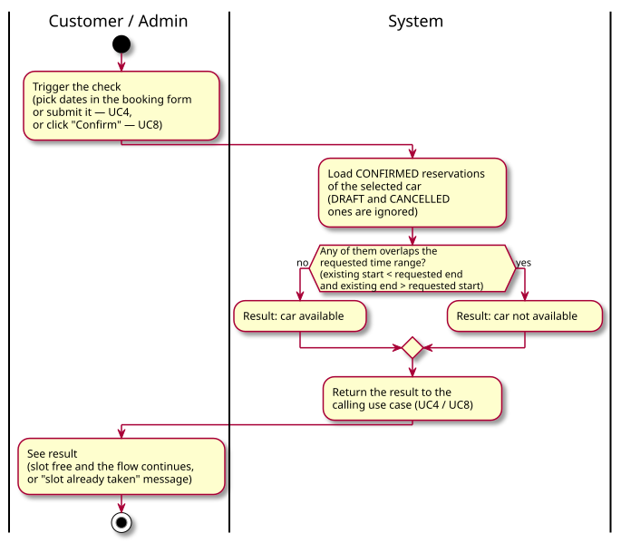

*Diagram source: [diagrams/activity-check-availability.puml](diagrams/activity-check-availability.puml).*

## UC5 — Cancel reservation

Use case: [UC5 — Cancel reservation](use-cases.md#uc5--cancel-reservation-)

Three independent guard clauses have to pass, in a fixed order, before a
cancellation succeeds — ownership (or admin), not already `CANCELLED`, and
not a `CONFIRMED` rental whose period has already started — so the diagram
reads top to bottom as exactly the sequence `crud.cancel_reservation`
evaluates them in. Any single failing check produces its own distinct error
and short-circuits the rest.

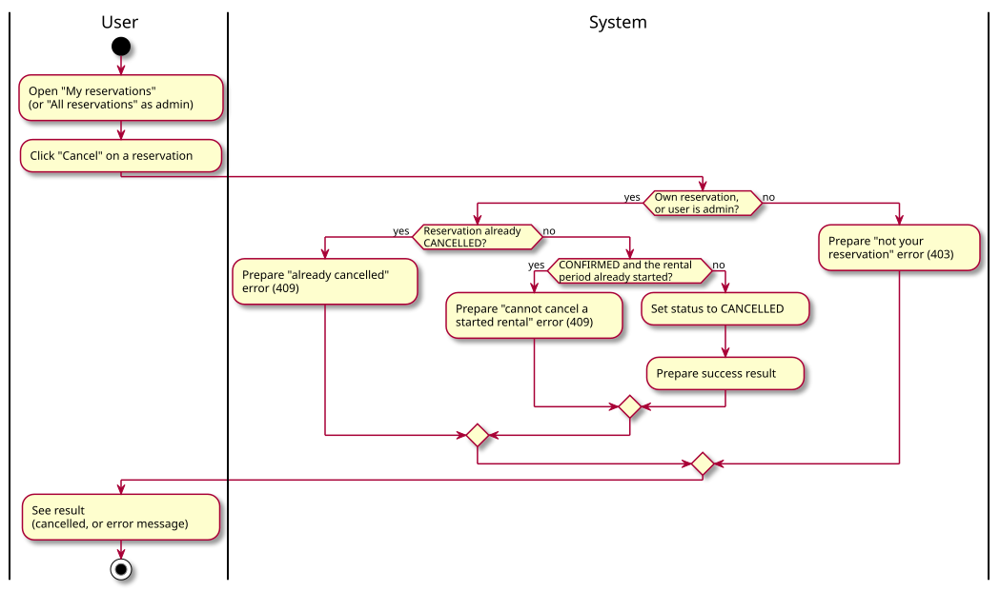

*Diagram source: [diagrams/activity-cancel-reservation.puml](diagrams/activity-cancel-reservation.puml).*

## UC6 — View my reservations

Use case: [UC6 — View my reservations](use-cases.md#uc6--view-my-reservations-)

The simplest flow in the system: one request, one response, no branching —
the System always returns exactly the logged-in customer's own
reservations and nothing else. That single difference (whose reservations
are returned) is also what distinguishes this use case from its
admin-only counterpart, UC10.

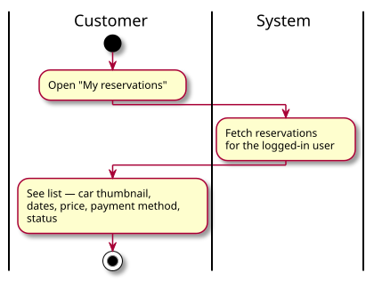

*Diagram source: [diagrams/activity-view-my-reservations.puml](diagrams/activity-view-my-reservations.puml).*

## UC7 — Contact support

Use case: [UC7 — Contact support](use-cases.md#uc7--contact-support-)

Everything here happens in the browser; the System swimlane exists only to
show that showing the contact panel and opening the phone/mail app are
handled by the frontend itself — there is no call to the backend anywhere
in this flow. The single `if` is optional: closing the panel without
clicking a contact method is just as valid an ending as using one.

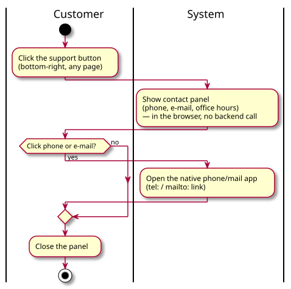

*Diagram source: [diagrams/activity-contact-support.puml](diagrams/activity-contact-support.puml).*

## UC8 — Confirm reservation

Use case: [UC8 — Confirm reservation](use-cases.md#uc8--confirm-reservation--admin-only)

Confirmation uses the same guard-clause style as cancellation: is the
reservation still `DRAFT`, then is the car still available. What makes this
flow different is that its success branch doesn't end once the status
flips to `CONFIRMED` — it continues straight into UC8a (send the
notification) before control returns to the admin, because notifying the
customer is part of what "confirming" means in this system, not a
side effect bolted on afterwards.

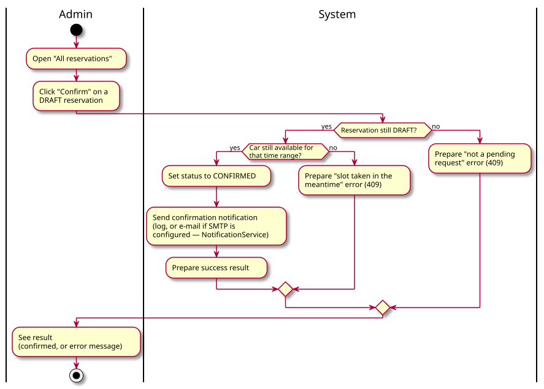

*Diagram source: [diagrams/activity-confirm-reservation.puml](diagrams/activity-confirm-reservation.puml).*

## UC8a — Send notification

Use case: [UC8a — Send notification](use-cases.md#uc8a--send-notification--include-part-of-uc8-external-boundary)

This is the only diagram in the system with three swimlanes instead of two,
because there are genuinely three independent parties involved: the System
that decides *whether* to attempt an e-mail at all, the Notification
Service that attempts it and decides whether it *succeeded*, and the
Customer who only materially benefits from the one branch where it did.
A failed send is deliberately swallowed — logged, not surfaced — so the
reservation the admin just confirmed is never rolled back because of an
e-mail problem.

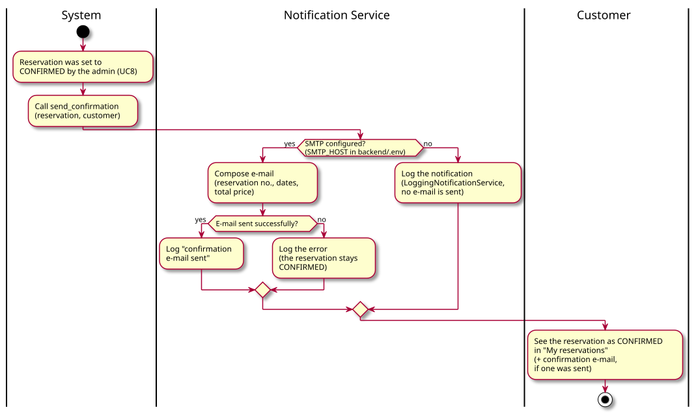

*Diagram source: [diagrams/activity-send-notification.puml](diagrams/activity-send-notification.puml).*

## UC9 — Manage fleet

Use case: [UC9 — Manage fleet](use-cases.md#uc9--manage-fleet--admin-only)

A single three-way `switch` replaces three separate flows for add / edit /
delete, since all three share the same shape in both swimlanes: the admin
fills in or confirms something, the System persists it, and the fleet list
is refreshed. Deleting is the only branch with a consequence that reaches
outside the fleet itself — every reservation for that car is removed along
with it — which is why that step is called out explicitly rather than left
as a plain "Delete Car".

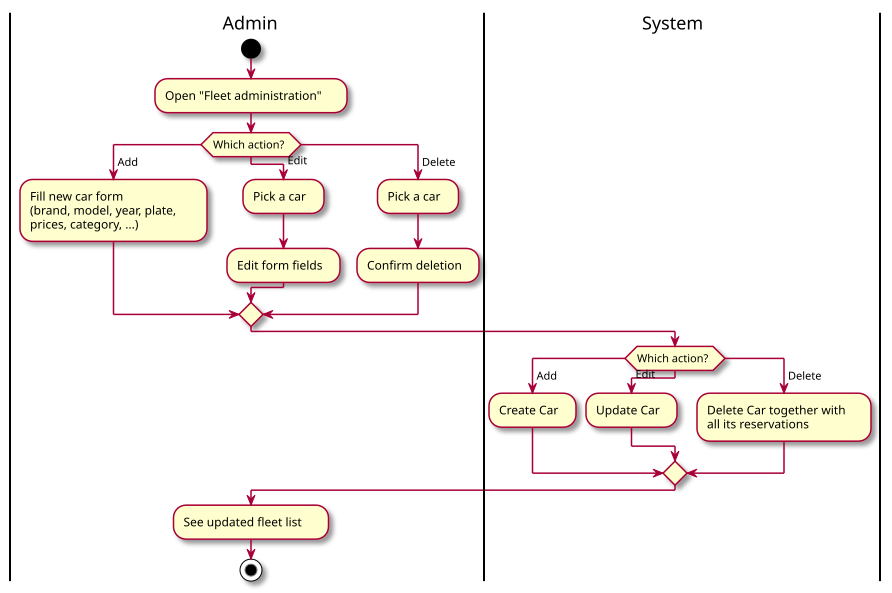

*Diagram source: [diagrams/activity-manage-fleet.puml](diagrams/activity-manage-fleet.puml).*

## UC10 — View all reservations

Use case: [UC10 — View all reservations](use-cases.md#uc10--view-all-reservations--admin-only)

Like UC6, this is a single request/response with no branching at all — the
difference is scope, not shape: every customer's reservations instead of
just the logged-in user's own. It is the admin-only entry point that feeds
both UC8 (confirm a pending one) and UC5 (cancel any one of them).

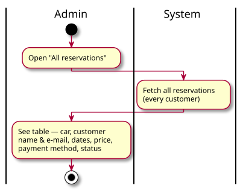

*Diagram source: [diagrams/activity-view-all-reservations.puml](diagrams/activity-view-all-reservations.puml).*
