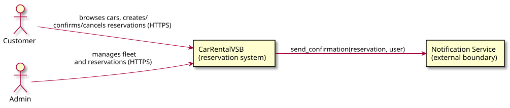
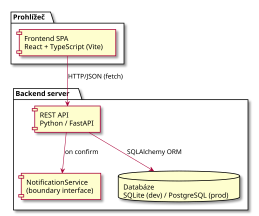

# Architecture and Decisions

## Overview (C4 — Context)



*Diagram source: [diagrams/context.puml](diagrams/context.puml) — PlantUML, the image is automatically re-rendered on every source change (see [.github/workflows/render-plantuml.yml](../.github/workflows/render-plantuml.yml)).*

## Containers (C4 — Container)



*Diagram source: [diagrams/container.puml](diagrams/container.puml).*

A more detailed breakdown of the repository structure and backend layering is
in [architecture.md](architecture.md) (written in the first iteration of the
project, its content remains valid). This document additionally contains the
decision log, the boundary description and the future pressure selected for
the C01 assignment.

## External / system boundary: Notification Service

The domain depends on the Notification Service through a small
`NotificationService` interface (`backend/app/notification.py`):

```python
class NotificationService(Protocol):
    def send_confirmation(self, reservation, user) -> bool: ...
```

For development, `LoggingNotificationService` is wired in, which simulates
sending and logs it. A real integration (email/SMS provider) plugs in by
implementing the same interface without changing the domain code in
`crud.py`/routers. Behavior on failure of this service (timeout, 5xx, retry)
is not handled yet — it's recorded as an `Unknown` in
[intent-and-change.md](intent-and-change.md) and is a candidate for a future
variant-B spike (boundary failure).

## Decision log

| # | Decision | Rationale |
|---|---|---|
| D1 | Backend: FastAPI + SQLAlchemy + SQLite (dev) | Automatic OpenAPI docs, type validation via Pydantic, zero DB configuration for a school project; easy migration to PostgreSQL without ORM code changes. |
| D2 | Frontend: React + TypeScript (Vite) | Component model matches the domain concepts (car list, reservation form); fast dev server. |
| D3 | Reservation has an explicit state (`DRAFT`/`CONFIRMED`/`CANCELLED`) instead of being "done" right away | The C01 assignment requires meaningful states and confirm/cancel operations; DRAFT also lets the customer reconsider without immediately blocking the slot for others. |
| D4 | The common overlap rule only applies to `CONFIRMED` reservations, not `DRAFT` | Two DRAFT reservations for the same slot can coexist (nobody has bindingly claimed it yet); it becomes binding only on confirmation — see `crud.is_car_available`. |
| D5 | The User is created/found automatically by email when a reservation is made (`get_or_create_user`), without login | In C01 we don't yet handle authentication (F5/F7 are `Planned`); but we need a real `User` entity in the data model per the assignment. |
| D6 | The Notification Service is a system boundary implemented as a local interface + logging stub, not a real HTTP integration | The goal of C01 is to have a defined and used system boundary in the code; the real integration and failure handling is future work (see the future pressure and open question above). |

## Selected future pressure

See [intent-and-change.md](intent-and-change.md#selected-future-pressure) —
**Category: Q (Quality/Scale)**, specifically 10x higher concurrency when
confirming reservations and the race-condition risk in `is_car_available` /
`confirm_reservation` over SQLite without transactional locking. It is not
implemented in C01, only recorded as a known risk for a future iteration.
