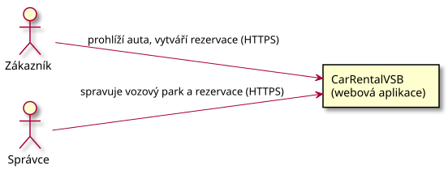
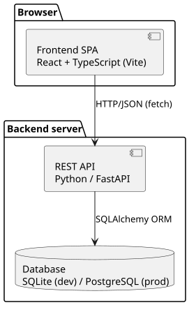

# System Architecture

> This document was written in the first iteration (pre-auth MVP) and is
> kept as a historical snapshot of the initial architecture reasoning — the
> technology choices and layering below still hold. For the current C4
> diagrams (with the Notification Service boundary), the decision log and
> everything added since (auth, admin, pricing), see
> [architecture-and-decisions.md](architecture-and-decisions.md).

## Overview (C4 — Context level)



*Diagram source: [diagrams/context-v1.puml](diagrams/context-v1.puml) — PlantUML, the image is automatically re-rendered on every source change.*

## Containers (C4 — Container level)



*Diagram source: [diagrams/container-v1.puml](diagrams/container-v1.puml).*

## Technology choice rationale

| Layer | Technology | Why |
|---|---|---|
| Backend | FastAPI (Python) | Typed schemas (Pydantic), automatic OpenAPI/Swagger docs for free, fast development, easy testing via `TestClient`. |
| ORM / DB access | SQLAlchemy 2.x | Standard in the Python ecosystem, easy move from SQLite to PostgreSQL without code changes. |
| Database (dev) | SQLite | Zero configuration, a single `carrental.db` file, ideal for a school project and local development. |
| Frontend | React + TypeScript (Vite) | Component model matches the domain concepts (car list, reservation form), type safety, fast dev server with HMR. |

## Repository structure

```
CarRentalVSB/
├── backend/
│   ├── app/
│   │   ├── main.py          # FastAPI app entry point, CORS, data seeding
│   │   ├── database.py      # SQLAlchemy engine/session
│   │   ├── models.py        # ORM models (User, Car, Reservation)
│   │   ├── schemas.py       # Pydantic schemas (request/response)
│   │   ├── crud.py          # database logic (availability, pricing, auth helpers)
│   │   ├── auth.py          # password hashing (bcrypt) + JWT issue/verify
│   │   ├── deps.py          # FastAPI dependencies: get_current_user, require_admin
│   │   ├── notification.py  # NotificationService boundary (logging / e-mail)
│   │   └── routers/         # API endpoints by domain (auth, cars, reservations, users)
│   ├── tests/                # pytest tests (unit/integration)
│   ├── .env.example          # SMTP / secret key configuration template
│   └── requirements.txt
├── frontend/
│   ├── public/cars/           # self-hosted car photos + CREDITS.md
│   └── src/
│       ├── api.ts             # HTTP client for the backend
│       ├── pricing.ts         # client-side mirror of the server price formula
│       ├── auth/               # AuthContext (JWT in localStorage)
│       └── components/         # CarCard, CarFilters, ReservationForm, AdminCars, ...
└── docs/                      # this (SWI) documentation
```

## Backend layering

The backend is split into three layers, which makes it easier to test and to
extend:

1. **Router (API layer)** — accepts HTTP requests, validates input via Pydantic schemas, applies auth/role dependencies (`deps.py`), returns HTTP responses and error codes.
2. **CRUD (domain/data logic)** — holds the rules over the data, e.g. `is_car_available`, `calculate_price`, testable in isolation.
3. **Model (persistence)** — SQLAlchemy ORM models mapped to database tables.

`auth.py` (password hashing, JWT) and `notification.py` (the external
boundary) sit alongside this as small, focused modules rather than being
folded into `crud.py` — each has a single reason to change.
