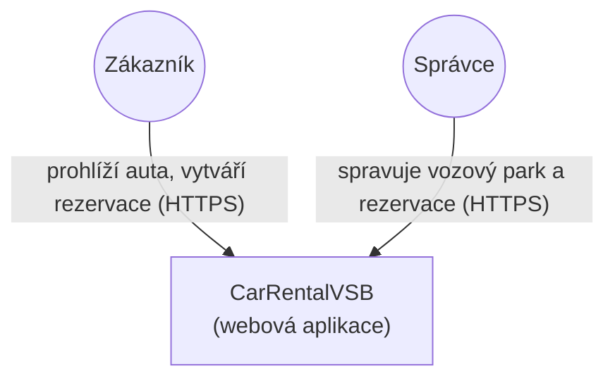
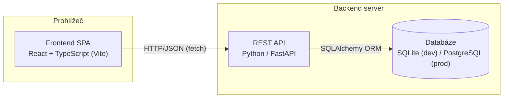

# Architektura systému

## Přehled (C4 — úroveň Context)



## Kontejnery (C4 — úroveň Container)



## Zdůvodnění volby technologií

| Vrstva | Technologie | Proč |
|---|---|---|
| Backend | FastAPI (Python) | Typované schema (Pydantic), automatická OpenAPI/Swagger dokumentace zdarma, rychlý vývoj, snadné testování přes `TestClient`. |
| ORM / DB přístup | SQLAlchemy 2.x | Standard v Python ekosystému, snadný přechod ze SQLite na PostgreSQL beze změny kódu. |
| Databáze (vývoj) | SQLite | Nulová konfigurace, soubor `carrental.db`, ideální pro školní projekt a lokální vývoj. |
| Frontend | React + TypeScript (Vite) | Komponentový model odpovídá doménovým konceptům (seznam aut, formulář rezervace), typová bezpečnost, rychlý dev server s HMR. |

## Struktura repozitáře

```
CarRentalVSB/
├── backend/
│   ├── app/
│   │   ├── main.py          # vstupní bod FastAPI aplikace, CORS, seed dat
│   │   ├── database.py      # SQLAlchemy engine/session
│   │   ├── models.py        # ORM modely (Car, Reservation)
│   │   ├── schemas.py       # Pydantic schémata (request/response)
│   │   ├── crud.py          # databázová logika (mj. kontrola dostupnosti)
│   │   └── routers/         # API endpointy po doménách
│   ├── tests/                # pytest testy (unit/integrační)
│   └── requirements.txt
├── frontend/
│   └── src/
│       ├── api.ts            # HTTP klient pro backend
│       ├── components/       # CarList, ReservationForm
│       └── App.tsx
└── docs/                      # tato dokumentace (SI)
```

## Vrstvení backendu

Backend je rozdělen do tří vrstev, což usnadňuje testování a budoucí rozšíření
(např. autentizaci nebo nové entity):

1. **Router (API vrstva)** — přijímá HTTP požadavky, validuje vstup přes Pydantic schémata, vrací HTTP odpovědi a chybové kódy.
2. **CRUD (doménová/datová logika)** — obsahuje pravidla nad daty, např. `is_car_available`, izolovaně testovatelná.
3. **Model (perzistence)** — SQLAlchemy ORM modely mapované na databázové tabulky.

Tato struktura je vědomě jednoduchá kvůli rozsahu MVP; v dalších iteracích
(viz [roadmap.md](roadmap.md)) přibude vrstva autentizace/autorizace.
