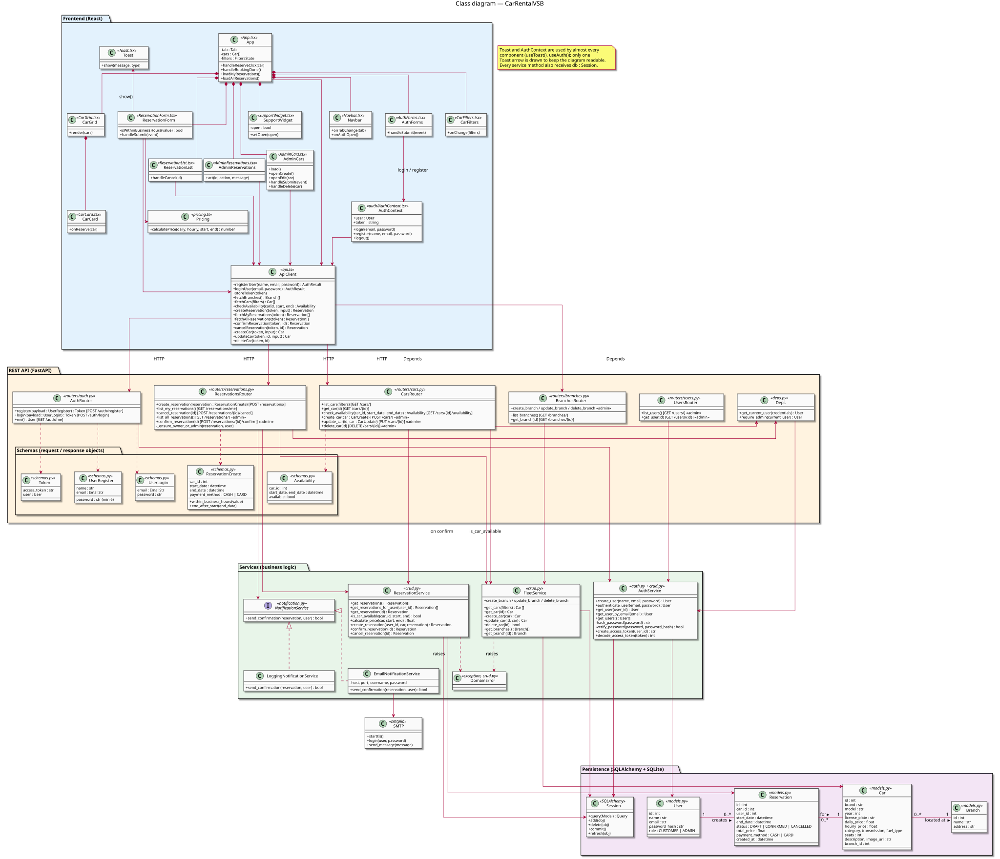

# Class Diagram

*Diagram source: [diagrams/class-system.puml](diagrams/class-system.puml) — PlantUML, the image is automatically re-rendered on every source change.*

## What this diagram specifies

The class diagram puts all the [sequence diagrams](sequence-diagrams.md) together into one
picture of the whole system. A sequence diagram shows *one* flow step by
step in time (e.g. "the admin confirms a reservation"); the class diagram
shows *every* class whose objects take part in those flows — what each one
knows (attributes), what it can do (operations) and how the classes are
linked. The two are kept in sync: every object in a sequence diagram is an
instance of a class from this diagram, every message sent to it is one of
that class's operations, and two objects only exchange messages when their
classes are linked here.

The model deliberately shows only the main classes of the system, not every
file or function in the code. It is read from the top down:

1. **The user interface (top)** — the two parts of the web app that have
   behaviour of their own:
   - `ReservationForm` — the booking form (UC4). Before anything is sent to
     the server it checks the dates against the opening hours, shows a
     price estimate and asks the server whether the car is free (UC4a);
     submitting is only possible when the slot is available. Its
     life cycle has its own [state diagram](state-diagrams.md#state-diagram--reservationform).
   - `SupportWidget` — the contact panel (UC7); it works only in the
     browser.
2. **The services (middle row)** carry out the use cases:
   - `AuthService` — registration, login, password hashing and the JWT
     token; `get_current_user` finds out who is calling (UC1, UC2, UC6).
   - `ReservationService` — creating, confirming and cancelling
     reservations, listing them, the availability check (UC4a) and the
     price calculation (UC4, UC5, UC6, UC8, UC10).
   - `FleetService` — listing and filtering cars, and adding, editing and
     deleting them (UC3, UC9).
   - `NotificationService` — an **interface** (UC8a): `ReservationService`
     calls it after a successful confirmation without knowing how the
     message is actually sent. The two dashed arrows with a hollow triangle
     show its two implementations — `LoggingNotificationService` (default,
     writes to the log) and `EmailNotificationService` (real e-mail, used
     once SMTP is configured).
3. **The domain classes (bottom row)** are the four database tables and how
   they relate, read along the chain: a `User` **creates** 0..*
   `Reservation`s, each reservation is **for** exactly one `Car`, and each
   car is **located at** exactly one `Branch`. Besides their attributes they
   have the operations the sequence diagrams send to them — e.g. a
   reservation can `confirm()`, `cancel()` and tell whether it
   `overlaps(start, end)` another time slot; a car gives its `get_prices()`
   for the price calculation; a user answers `is_admin()`.

The dashed arrows between the rows say which service uses or creates
(`«instantiate»`) which domain object.

How the model maps to the code: the three services are the FastAPI routers
in `backend/app/routers/` together with the functions they call in
`crud.py`, `auth.py` and `deps.py` (their operation names are the real
function names); `NotificationService` and its two implementations are real
classes in `notification.py`; the domain classes are the SQLAlchemy models
in `models.py`; `ReservationForm` and `SupportWidget` are React components
in `frontend/src/components/`. The operations of the domain classes (`confirm()`,
`overlaps()`, …) are how the design model describes what the services do
with those objects — in the code the services change the fields directly
(e.g. `reservation.status = CONFIRMED`) and the overlap check is a single
database query. The rest of the web app (navigation, lists, the admin
pages, the HTTP client) and the database are left out of the diagrams:
they only pass the requests and the data through.

**Example — following one use case through the diagram (UC8, confirm a
reservation):** the admin calls `ReservationService.confirm_reservation(id)`
(`POST /reservations/{id}/confirm`) → the service asks the admin's `User`
object `is_admin()`, loads the `Reservation`, checks its status, re-checks
availability (UC4a) and calls `confirm()` on it → finally it calls
`NotificationService.send_confirmation`. The [sequence diagram of UC8](sequence-diagrams.md#uc8--confirm-reservation)
shows exactly these objects and calls, step by step in time.
