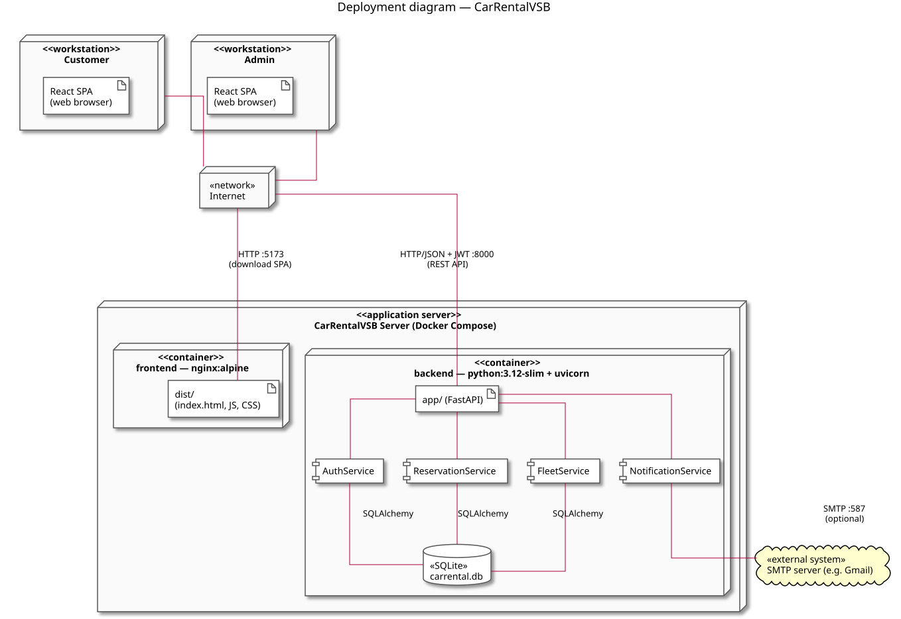

# Deployment Diagram

A deployment diagram shows the configuration of the run-time processing
elements — the hardware (*nodes*) the system runs on, what software
(*artifacts*) is deployed on each node, and how the nodes are connected.

*Diagram source: [diagrams/deployment.puml](diagrams/deployment.puml).*

## Nodes

| Node | What runs there |
|---|---|
| **«workstation» Customer**, **«workstation» Admin** | Any computer with a web browser. The browser downloads the React SPA and runs it — the booking form, the lists, the admin pages all run here, on the user's machine. Customer and admin use the same SPA; the admin only sees more tabs after logging in. |
| **«network» Internet** | Connects the workstations to the server. |
| **«application server» CarRentalVSB Server** | One machine with Docker that runs the two containers from `docker-compose.yml` (`docker compose up --build`). |
| **«container» frontend** | Image built from `frontend/Dockerfile`: the SPA is compiled (`npm run build`) into static files `dist/` (`index.html`, JS, CSS), which **nginx** serves. Port 80 in the container, published as **5173**. No Node.js at run time — nginx only hands the files to the browser. |
| **«container» backend** | Image built from `backend/Dockerfile` (`python:3.12-slim`): the FastAPI application `app/` run by **uvicorn** on port **8000**. Inside it are the services from the [class diagram](class-diagram.md) — `AuthService`, `ReservationService`, `FleetService`, `NotificationService` — and the **SQLite** database file `carrental.db`. |
| **«external system» SMTP server** | E.g. Gmail. Used only when the `SMTP_*` variables are set (see `backend/.env.example`); otherwise `LoggingNotificationService` just writes the confirmation to the log and nothing leaves the server. |

## Connections

| From → To | Protocol | What travels |
|---|---|---|
| Browser → frontend container | HTTP, port 5173 | Once, when the page opens: the SPA files (`index.html`, JS, CSS) and car photos. |
| Browser → backend container | HTTP/JSON, port 8000, `Authorization: Bearer <JWT>` | Every call of the REST API ([api-design.md](api-design.md)) — the SPA talks to the backend **directly**, not through nginx (`VITE_API_URL`, default `http://localhost:8000`). |
| Services → `carrental.db` | SQLAlchemy (file access) | Reads and writes of users, cars, branches, reservations. |
| `NotificationService` → SMTP server | SMTP with STARTTLS, port 587 | The confirmation e-mail after an admin confirms a reservation (UC8a). |

## Notes on the current deployment

- **One server, two containers.** For the course demo the "server" and the
  "workstations" are usually the same laptop (`localhost`); the diagram
  shows the roles of the nodes, which stay the same when the server is a
  separate machine.
- **The database lives inside the backend container**, not on a volume, so
  it is recreated (and re-seeded with the demo accounts and fleet) whenever
  the container is recreated. This matches the "SQLite for development"
  scope in [requirements.md](requirements.md). For production the plan in
  [architecture-and-decisions.md](architecture-and-decisions.md) (D1) is
  PostgreSQL — in the diagram that would be a separate «database server»
  node (or a third container) connected to the backend over TCP instead of
  the `carrental.db` file; the code only changes its connection string,
  thanks to SQLAlchemy.
- **Configuration comes from environment variables** (`SECRET_KEY`,
  `SMTP_*`), passed into the backend container by `docker-compose.yml` —
  the same image runs with or without real e-mail.
