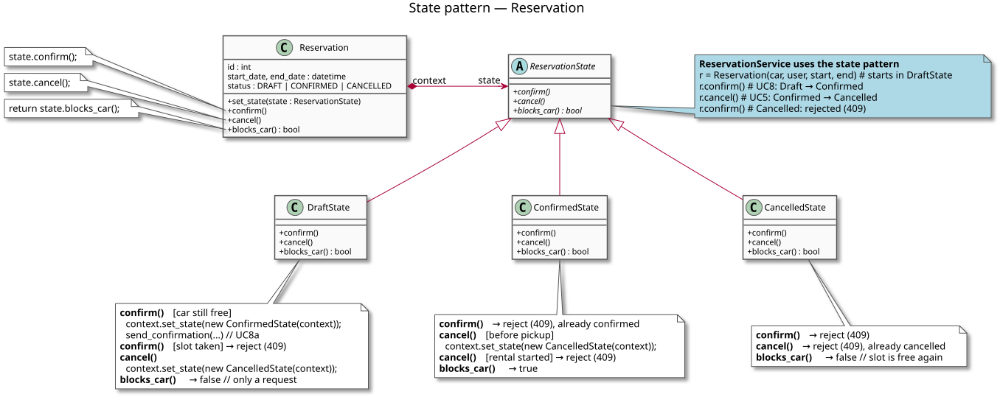

# Design Patterns — State

> **State** allows an object to alter its behaviour when its internal state
> changes. The object will appear to change its class.

## Where the pattern fits

The [state diagram of `Reservation`](state-diagrams.md#state-diagram--reservation)
shows that a reservation behaves differently in each of its three states —
the same operation succeeds in one state and is refused in another:

| Operation | `DRAFT` | `CONFIRMED` | `CANCELLED` |
|---|---|---|---|
| `confirm()` (UC8) | → `CONFIRMED` if the car is still free, otherwise 409 | refused (409) | refused (409) |
| `cancel()` (UC5) | → `CANCELLED` | → `CANCELLED` before pickup, refused (409) once the rental has started | refused (409) |
| `blocks_car()` (UC4a) | no — only a request | yes | no — the slot is free again |

Without the pattern, every operation has to ask "which state am I in?" with
an `if` on `status` — this is how `confirm_reservation` and
`cancel_reservation` in `backend/app/crud.py` are written today, and how the
availability check in `is_car_available` filters on `status == CONFIRMED`.
Each new state (e.g. a future `COMPLETED` after the car is returned) would
mean editing every one of those `if`s.

The State pattern moves the behaviour of each state into its own class. The
`Reservation` only delegates to its current state object, and the state
object itself decides what happens and which state comes next.

## Class diagram



*Diagram source: [diagrams/pattern-state.puml](diagrams/pattern-state.puml).*

The roles of the pattern:

| Role in the pattern | Class in our project | Responsibility |
|---|---|---|
| **Context** | `Reservation` | The object the rest of the system works with. Holds a reference to its current `state` and forwards every state-dependent call to it (`state.confirm()`, …). `set_state()` is how a state switches it to the next one. |
| **State** (abstract) | `ReservationState` | The common interface of all states: `confirm()`, `cancel()`, `blocks_car()`. |
| **Concrete states** | `DraftState`, `ConfirmedState`, `CancelledState` | One class per state from the state diagram. Each implements the operations the way they behave in that state, and calls `context.set_state(...)` for a transition. |
| **Client** | `ReservationService` | Calls `r.confirm()` / `r.cancel()` without knowing which state the reservation is in. |

Each transition of the state diagram is one `set_state` call in the diagram
above — `DraftState.confirm()` is the transition `DRAFT → CONFIRMED`,
`DraftState.cancel()` and `ConfirmedState.cancel()` are the two transitions
to `CANCELLED`. Each refused event (`/ reject (409)` in the state diagram) is
an operation that raises an error instead of changing the state. The two
sub-states of `CONFIRMED` (*Before pickup* / *Rental started*) stay inside
`ConfirmedState.cancel()` as a check of `start_date` against the current
time, because they are not stored either.

## How it maps to code

A sketch in Python of how the pattern would replace the `if`s in `crud.py`
(`DomainError` is the existing exception the routers turn into
`409 Conflict`):

```python
class ReservationState(ABC):
    def __init__(self, context: "Reservation"):
        self.context = context

    @abstractmethod
    def confirm(self) -> None: ...
    @abstractmethod
    def cancel(self) -> None: ...
    @abstractmethod
    def blocks_car(self) -> bool: ...


class DraftState(ReservationState):
    def confirm(self):
        if not is_car_available(self.context.car, self.context.start_date, self.context.end_date):
            raise DomainError("Auto je v tomto termínu už jinou rezervací potvrzeno")
        self.context.set_state(ConfirmedState(self.context))

    def cancel(self):
        self.context.set_state(CancelledState(self.context))

    def blocks_car(self):
        return False  # a DRAFT is only a request


class ConfirmedState(ReservationState):
    def confirm(self):
        raise DomainError("Rezervaci ve stavu CONFIRMED nelze potvrdit")

    def cancel(self):
        if self.context.start_date <= now():
            raise DomainError("Potvrzenou rezervaci nelze zrušit poté, co již začal termín výpůjčky")
        self.context.set_state(CancelledState(self.context))

    def blocks_car(self):
        return True


class CancelledState(ReservationState):
    def confirm(self):
        raise DomainError("Rezervaci ve stavu CANCELLED nelze potvrdit")

    def cancel(self):
        raise DomainError("Rezervace je již zrušena")

    def blocks_car(self):
        return False


class Reservation(Base):
    ...
    def set_state(self, state: ReservationState) -> None:
        self.state = state
        self.status = STATUS_OF[type(state)]  # the column stays the stored value

    def confirm(self):    self.state.confirm()
    def cancel(self):     self.state.cancel()
    def blocks_car(self): return self.state.blocks_car()
```

The `status` column in the database stays as it is — it is only the stored
name of the state. When a reservation is loaded, its `state` object is
created from `status` (`DRAFT` → `DraftState`, …); when the state changes,
`set_state` writes the new `status` back. The service then becomes:

```python
def confirm_reservation(db, reservation_id):
    r = get_reservation(db, reservation_id)
    r.confirm()               # the current state decides what happens
    db.commit()
    notification_service.send_confirmation(r, r.user)   # UC8a
    return r
```

## What we gain

- **No `if status == ...` in the services.** The rules of one state are in
  one class, next to each other, instead of being spread over
  `confirm_reservation`, `cancel_reservation` and `is_car_available`.
- **A new state is a new class.** E.g. `COMPLETED` (car returned) would be a
  `CompletedState` plus one transition in `ConfirmedState`; the existing
  states and the services would not change.
- **The code matches the design one to one** — one state in the
  [state diagram](state-diagrams.md#state-diagram--reservation) is one class,
  one transition is one `set_state` call, one refused event is one raised
  `DomainError`.
