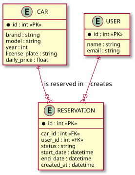
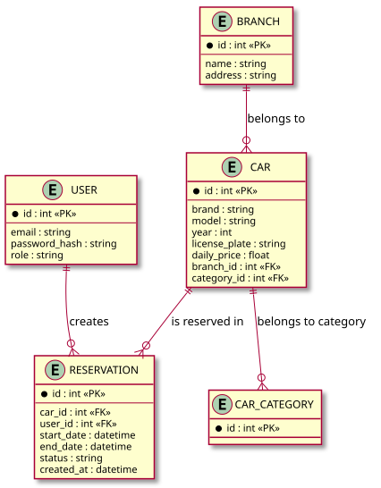

# Domain / ER Model

## Current state (C01)

*Diagram source: [diagrams/er-current.puml](diagrams/er-current.puml) — PlantUML, the image is automatically re-rendered on every source change.*

**Reservation states:** `DRAFT → CONFIRMED → (terminal)`, `DRAFT → CANCELLED`,
`CONFIRMED → CANCELLED` (only before `start_date`, see the domain-specific
rule in [intent-and-change.md](intent-and-change.md)).

**Consistency rule (common business rule):** for a given `car_id`, the
database must never contain two reservations in `CONFIRMED` state with
overlapping `[start_date, end_date)` intervals. This rule is enforced at the
application level (`crud.is_car_available`), not by a database constraint —
see [testing-strategy.md](testing-strategy.md) and the recorded risk under
`Selected future pressure` in [intent-and-change.md](intent-and-change.md).

In C01, the `User` is created automatically by email when a reservation is
made (without registration/login) — see `Assumption` in
[intent-and-change.md](intent-and-change.md).

## Target model (after further iterations)

*Diagram source: [diagrams/er-target.puml](diagrams/er-target.puml).*

Extensions compared to the MVP: registered users (`USER`) replace the plain
`customer_name`/`customer_email`, a branch (`BRANCH`) and car category are
added, plus a reservation status (`status`: pending / confirmed / cancelled).
