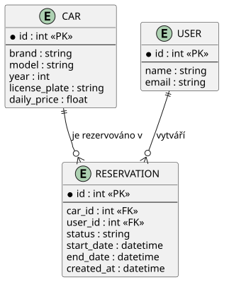
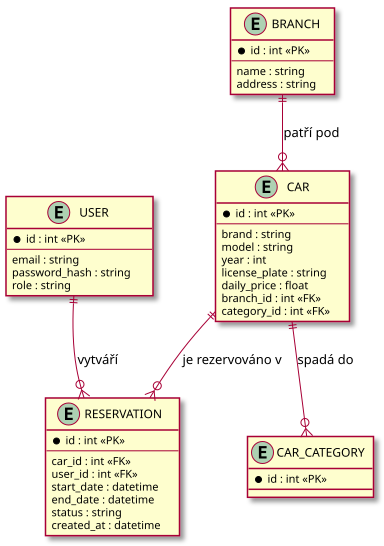

# Doménový / ER model

## Aktuální stav (C01)

*Zdroj diagramu: [diagrams/er-aktualni.puml](diagrams/er-aktualni.puml) — PlantUML, obrázek se automaticky přegeneruje při každé změně zdroje.*

**Stavy rezervace:** `DRAFT → CONFIRMED → (terminál)`, `DRAFT → CANCELLED`,
`CONFIRMED → CANCELLED` (jen před `start_date`, viz domain-specific rule v
[intent-and-change.md](intent-and-change.md)).

**Pravidlo konzistence (common business rule):** pro dané `car_id` se nesmí
v databázi vyskytnout dvě rezervace ve stavu `CONFIRMED` s překrývajícím se
intervalem `[start_date, end_date)`. Toto pravidlo je vynucováno na úrovni
aplikace (`crud.is_car_available`), ne databázovým constraintem — viz
[testovaci-strategie.md](testovaci-strategie.md) a zaznamenané riziko pod
`Selected future pressure` v [intent-and-change.md](intent-and-change.md).

`User` se v C01 zakládá automaticky podle e-mailu při vytvoření rezervace
(bez registrace/přihlášení) — viz `Assumption` v
[intent-and-change.md](intent-and-change.md).

## Cílový model (po dalších iteracích)

*Zdroj diagramu: [diagrams/er-cilovy.puml](diagrams/er-cilovy.puml).*

Rozšíření oproti MVP: registrovaní uživatelé (`USER`) nahrazují prosté
`customer_name`/`customer_email`, přibývá pobočka (`BRANCH`), kategorie vozu a
stav rezervace (`status`: čeká / potvrzena / zrušena).
