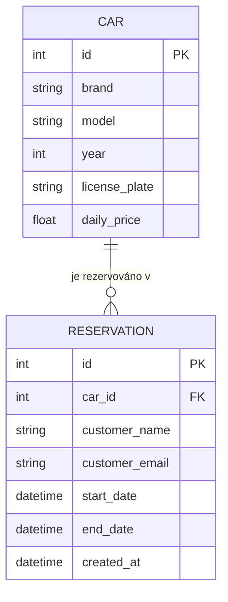
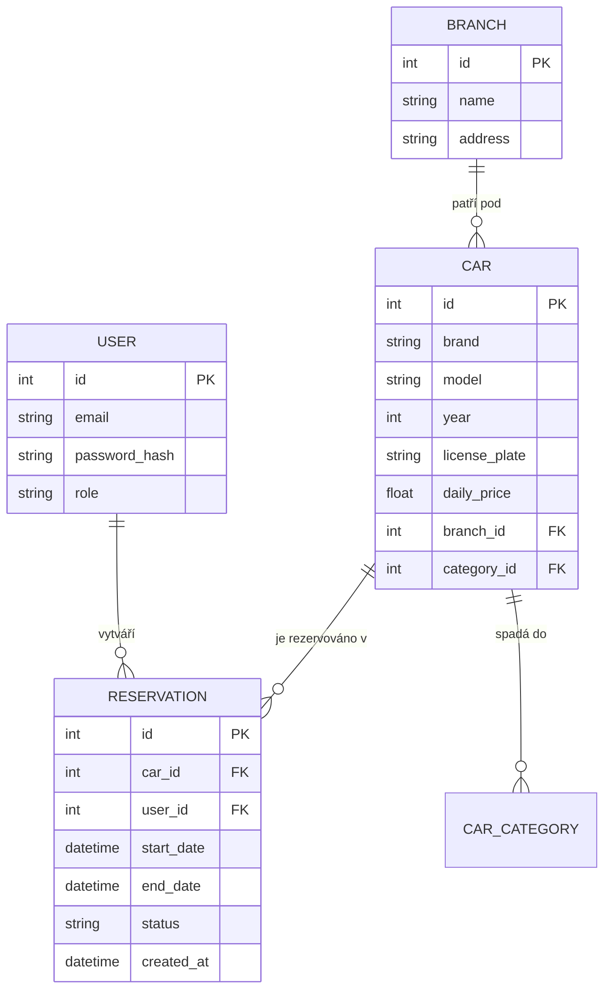

# Doménový / ER model

## Aktuální stav (MVP)

**Pravidlo konzistence:** pro dané `car_id` se nesmí v databázi vyskytnout dvě
rezervace s překrývajícím se intervalem `[start_date, end_date)`. Toto pravidlo
je vynucováno na úrovni aplikace (`crud.is_car_available`), ne databázovým
constraintem — viz [testovaci-strategie.md](testovaci-strategie.md).

## Cílový model (po dalších iteracích)

Rozšíření oproti MVP: registrovaní uživatelé (`USER`) nahrazují prosté
`customer_name`/`customer_email`, přibývá pobočka (`BRANCH`), kategorie vozu a
stav rezervace (`status`: čeká / potvrzena / zrušena).
