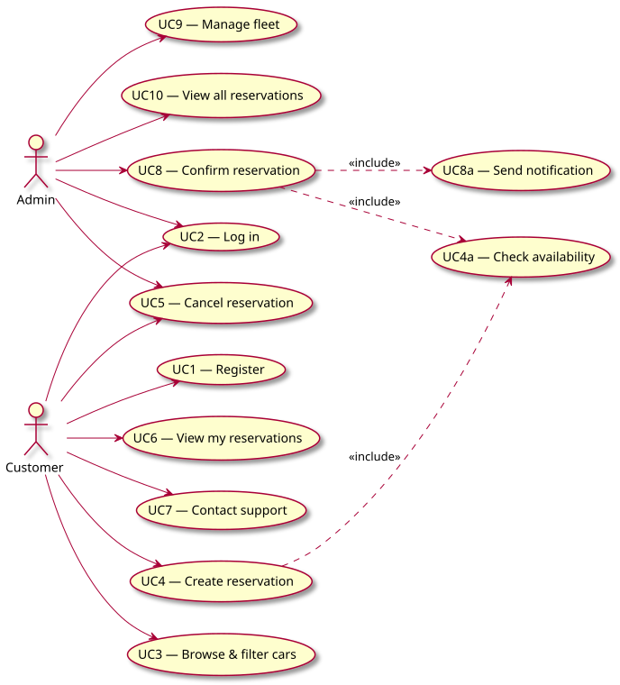

# Případy užití (Use Cases)

## Diagram (cílový stav systému)

*Zdroj diagramu: [diagrams/use-case.puml](diagrams/use-case.puml) — PlantUML, obrázek se automaticky přegeneruje při každé změně zdroje.*

Legenda stavu: ✅ implementováno v MVP, ⏳ plánováno v dalších iteracích.

## UC1 — Prohlížet nabídku aut ✅

| | |
|---|---|
| Aktér | Zákazník |
| Předpoklad | — |
| Hlavní tok | 1. Zákazník otevře aplikaci. 2. Systém zobrazí seznam všech aut se značkou, modelem, rokem a cenou za den. |
| Alternativní tok | Vozový park je prázdný → systém zobrazí informační hlášku. |
| Výsledek | Zákazník vidí nabídku aut. |

## UC2 — Vytvořit rezervaci ✅

| | |
|---|---|
| Aktér | Zákazník |
| Předpoklad | Vybrané auto existuje (UC1). |
| Hlavní tok | 1. Zákazník zvolí auto. 2. Zadá jméno, e-mail a termín od–do (`POST /reservations/`). 3. Systém najde/založí `User` podle e-mailu. 4. Systém provede UC7 (ověření dostupnosti proti CONFIRMED rezervacím). 5. Pokud je termín volný, systém rezervaci vytvoří ve stavu `DRAFT`. |
| Alternativní tok A1 | Termín koliduje s **potvrzenou** rezervací → systém vrátí chybu 409. |
| Alternativní tok A2 | `end_date` <= `start_date` → systém vrátí validační chybu 422. |
| Výsledek | V databázi existuje nová rezervace ve stavu `DRAFT` vázaná na dané auto, uživatele a termín. |

## UC7 — Ověřit dostupnost auta ✅

| | |
|---|---|
| Aktér | Systém / Zákazník (`GET /cars/{id}/availability`) |
| Hlavní tok | Systém porovná požadovaný termín se všemi `CONFIRMED` rezervacemi daného auta; pokud se žádný interval nepřekrývá, auto je dostupné. |

## UC3 — Potvrdit rezervaci ✅

| | |
|---|---|
| Aktér | Zákazník |
| Předpoklad | Rezervace existuje ve stavu `DRAFT` (UC2). |
| Hlavní tok | 1. Zákazník potvrdí rezervaci (`POST /reservations/{id}/confirm`). 2. Systém znovu provede UC7 proti ostatním `CONFIRMED` rezervacím. 3. Pokud je termín stále volný, stav se změní na `CONFIRMED` a systém odešle notifikaci (UC9). |
| Alternativní tok A1 | Rezervace není ve stavu `DRAFT` (už potvrzena/zrušena) → chyba 409. |
| Alternativní tok A2 | Mezitím byla potvrzena jiná rezervace na překrývající se termín → chyba 409, common business rule se tím dodrží. |
| Výsledek | Rezervace má stav `CONFIRMED`, zákazník dostal notifikaci. |

## UC9 — Odeslat notifikaci ✅ (interní, součást UC3, boundary)

| | |
|---|---|
| Aktér | Notification Service (externí boundary) |
| Hlavní tok | Systém po potvrzení rezervace zavolá `NotificationService.send_confirmation`; v C01 je zapojen `LoggingNotificationService` (simulace úspěchu). |

## UC8 — Zrušit rezervaci ✅

| | |
|---|---|
| Aktér | Zákazník |
| Předpoklad | Rezervace existuje a není `CANCELLED`. |
| Hlavní tok | 1. Zákazník zruší rezervaci (`POST /reservations/{id}/cancel`). 2. Systém nastaví stav `CANCELLED`. |
| Alternativní tok A1 | Rezervace je již `CANCELLED` → chyba 409. |
| Alternativní tok A2 (domain-specific rule) | Rezervace je `CONFIRMED` a `start_date` už nastal → chyba 409, nelze zrušit rozjetou výpůjčku. |
| Výsledek | Rezervace má stav `CANCELLED`, termín je opět volný pro jiné potvrzení. |

## UC4 — Registrace / přihlášení ⏳

| | |
|---|---|
| Aktéři | Zákazník, Správce |
| Hlavní tok | Uživatel zadá e-mail a heslo; systém ověří údaje a vystaví přístupový token. |

## UC5 — Spravovat vozový park ⏳

| | |
|---|---|
| Aktér | Správce |
| Předpoklad | Správce je přihlášen. |
| Hlavní tok | Správce přidává, upravuje nebo odebírá auta ve vozovém parku. |

## UC6 — Spravovat rezervace ⏳

| | |
|---|---|
| Aktér | Správce |
| Předpoklad | Správce je přihlášen. |
| Hlavní tok | Správce vidí přehled všech rezervací, může je potvrdit nebo zrušit. |
