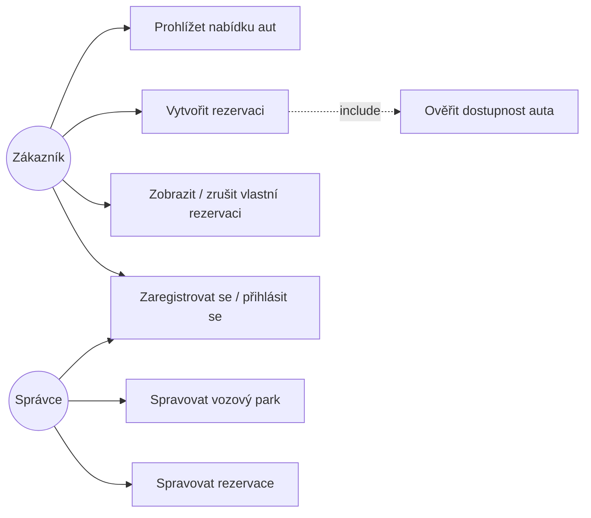

# Případy užití (Use Cases)

## Diagram (cílový stav systému)

Legenda stavu: ✅ implementováno v MVP, ⏳ plánováno v dalších iteracích.

## UC1 — Prohlížet nabídku aut ✅

| | |
|---|---|
| Aktér | Zákazník |
| Předpoklad | — |
| Hlavní tok | 1. Zákazník otevře aplikaci. 2. Systém zobrazí seznam všech aut se značkou, modelem, rokem a cenou za den. |
| Alternativní tok | Vozový park je prázdný → systém zobrazí informační hlášku. |
| Výsledek | Zákazník vidí nabídku aut. |

## UC2 — Vytvořit rezervaci ✅

| | |
|---|---|
| Aktér | Zákazník |
| Předpoklad | Vybrané auto existuje (UC1). |
| Hlavní tok | 1. Zákazník zvolí auto a klikne na „Rezervovat“. 2. Zadá jméno, e-mail a termín od–do. 3. Systém provede UC7 (ověření dostupnosti). 4. Pokud je termín volný, systém rezervaci vytvoří a zobrazí potvrzení. |
| Alternativní tok A1 | Termín koliduje s existující rezervací → systém vrátí chybu 409 a zákazník zadá jiný termín. |
| Alternativní tok A2 | `end_date` <= `start_date` → systém vrátí validační chybu 422. |
| Výsledek | V databázi existuje nová rezervace vázaná na dané auto a termín. |

## UC7 — Ověřit dostupnost auta ✅ (interní, součást UC2)

| | |
|---|---|
| Aktér | Systém |
| Hlavní tok | Systém porovná požadovaný termín se všemi existujícími rezervacemi daného auta; pokud se žádný interval nepřekrývá, auto je dostupné. |

## UC3 — Zobrazit / zrušit vlastní rezervaci ⏳

| | |
|---|---|
| Aktér | Zákazník |
| Předpoklad | Zákazník je přihlášen (UC4) nebo se identifikuje e-mailem. |
| Hlavní tok | 1. Zákazník zobrazí přehled svých rezervací. 2. Zvolí rezervaci ke zrušení. 3. Systém rezervaci zruší a uvolní termín. |

## UC4 — Registrace / přihlášení ⏳

| | |
|---|---|
| Aktéři | Zákazník, Správce |
| Hlavní tok | Uživatel zadá e-mail a heslo; systém ověří údaje a vystaví přístupový token. |

## UC5 — Spravovat vozový park ⏳

| | |
|---|---|
| Aktér | Správce |
| Předpoklad | Správce je přihlášen. |
| Hlavní tok | Správce přidává, upravuje nebo odebírá auta ve vozovém parku. |

## UC6 — Spravovat rezervace ⏳

| | |
|---|---|
| Aktér | Správce |
| Předpoklad | Správce je přihlášen. |
| Hlavní tok | Správce vidí přehled všech rezervací, může je potvrdit nebo zrušit. |
