# Sequence Diagrams

This document holds the sequence diagram of every use case described in
[use-cases.md](use-cases.md). **A sequence diagram** shows the flow of a
use case as a message exchange between a few objects of the classes from
the [class diagram](class-diagram.md): the service that carries out the use
case and the domain objects it works with (e.g.
`:ReservationService`, `c : Car`, `r : Reservation`). Every message is
one of the receiving class's operations; `«create»` / `«destroy»` show
an object coming into or going out of existence, and `alt`, `opt`,
`loop` and `break` frames show the alternative flows. The first message
from the actor also shows the HTTP method and path it is sent with, and
the replies show the HTTP status codes, so the diagram can be checked
against the running API (see also [api-design.md](api-design.md)).
`ref` frames point to a flow that is drawn in full in another diagram
(e.g. UC4a inside UC4 and UC8).

## UC1 — Register

Use case: [UC1 — Register](use-cases.md#uc1--register-)

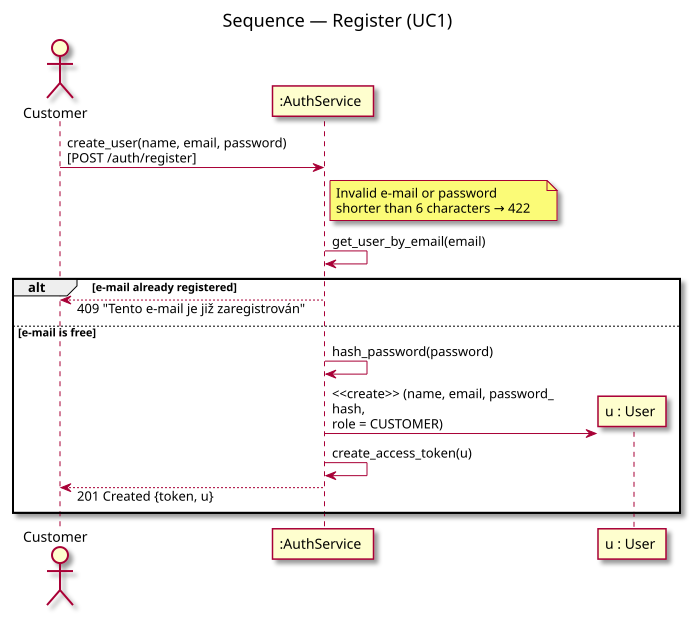

*Diagram source: [diagrams/sequence-register.puml](diagrams/sequence-register.puml).*

## UC2 — Log in

Use case: [UC2 — Log in](use-cases.md#uc2--log-in-)

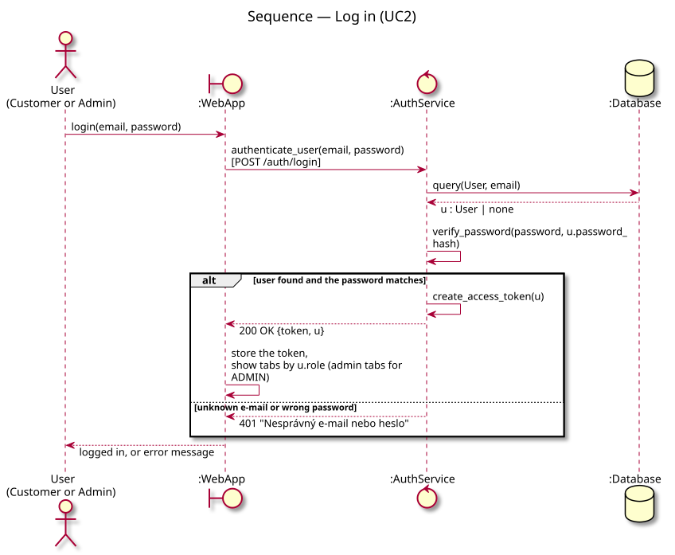

*Diagram source: [diagrams/sequence-login.puml](diagrams/sequence-login.puml).*

## UC3 — Browse & filter cars

Use case: [UC3 — Browse & filter cars](use-cases.md#uc3--browse--filter-cars-)

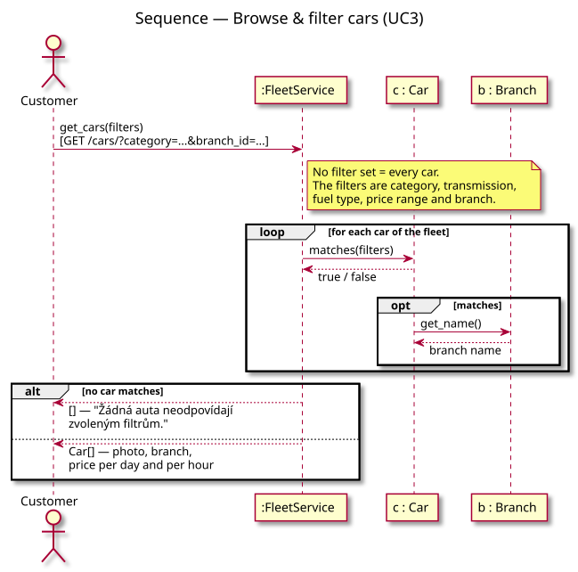

*Diagram source: [diagrams/sequence-browse-cars.puml](diagrams/sequence-browse-cars.puml).*

## UC4 — Create reservation

Use case: [UC4 — Create reservation](use-cases.md#uc4--create-reservation-)

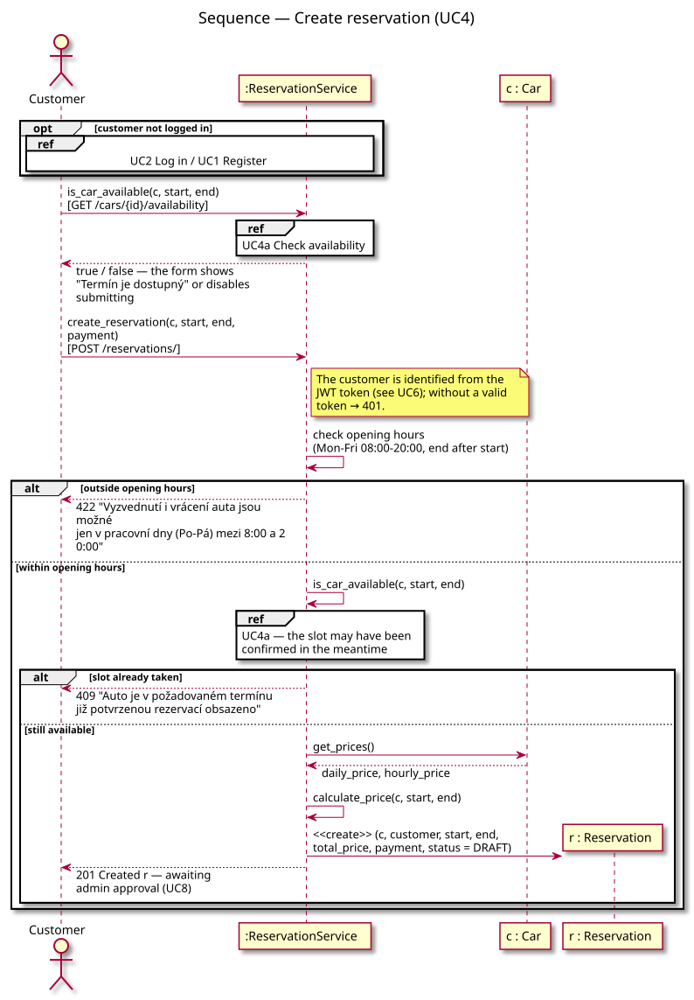

*Diagram source: [diagrams/sequence-make-reservation.puml](diagrams/sequence-make-reservation.puml).*

## UC4a — Check availability

Use case: [UC4a — Check availability](use-cases.md#uc4a--check-availability--include-part-of-uc4-and-uc8)

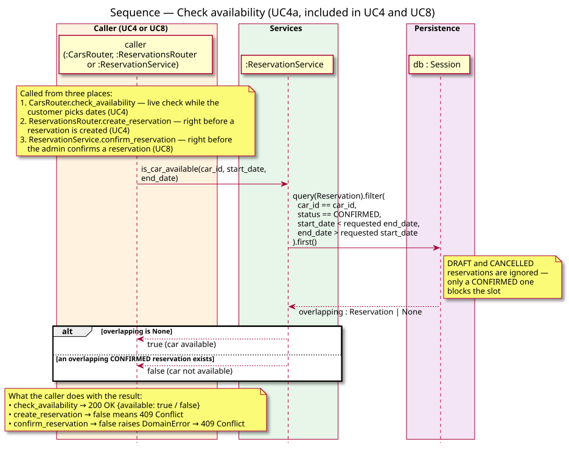

*Diagram source: [diagrams/sequence-check-availability.puml](diagrams/sequence-check-availability.puml).*

## UC5 — Cancel reservation

Use case: [UC5 — Cancel reservation](use-cases.md#uc5--cancel-reservation-)

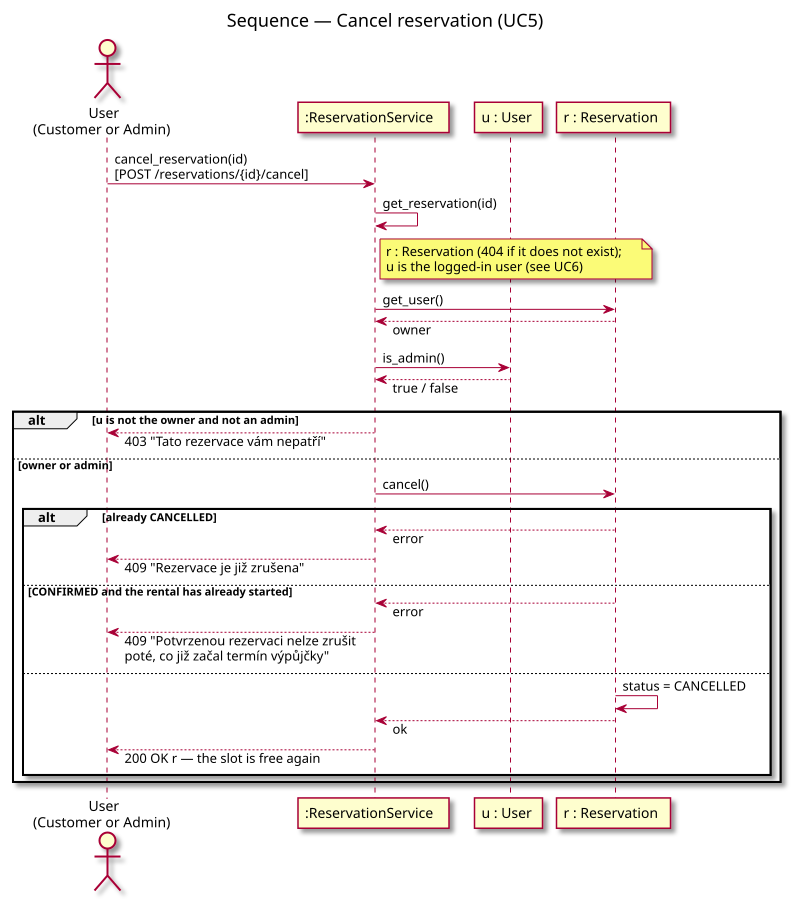

*Diagram source: [diagrams/sequence-cancel-reservation.puml](diagrams/sequence-cancel-reservation.puml).*

## UC6 — View my reservations

Use case: [UC6 — View my reservations](use-cases.md#uc6--view-my-reservations-)

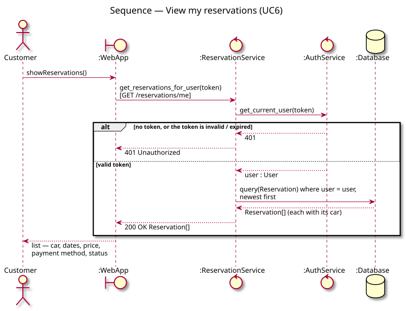

*Diagram source: [diagrams/sequence-view-my-reservations.puml](diagrams/sequence-view-my-reservations.puml).*

## UC7 — Contact support

Use case: [UC7 — Contact support](use-cases.md#uc7--contact-support-)

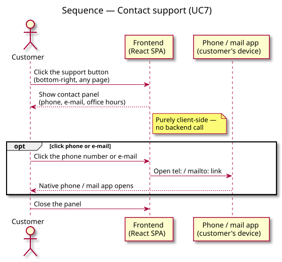

*Diagram source: [diagrams/sequence-contact-support.puml](diagrams/sequence-contact-support.puml).*

## UC8 — Confirm reservation

Use case: [UC8 — Confirm reservation](use-cases.md#uc8--confirm-reservation--admin-only)

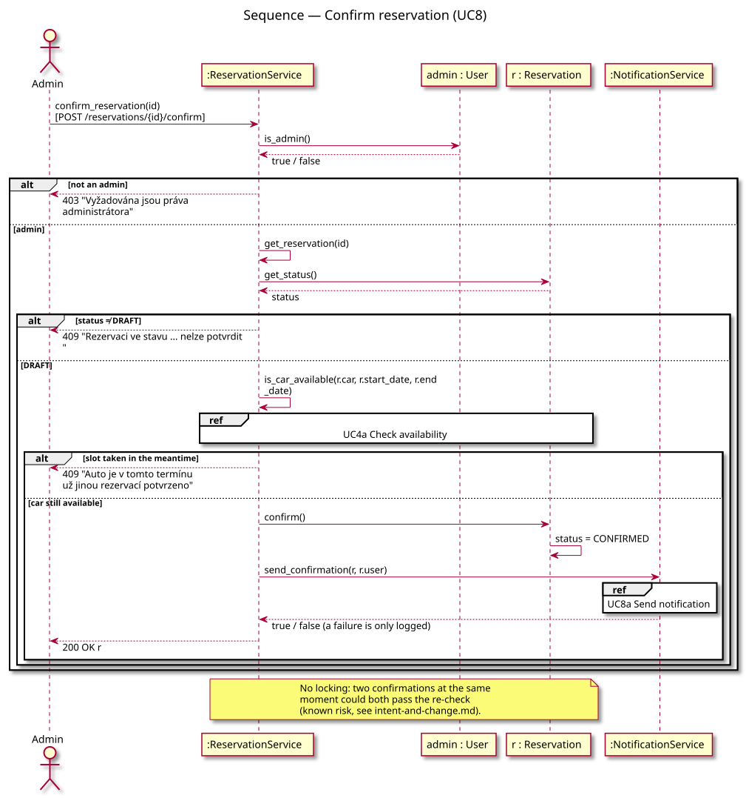

*Diagram source: [diagrams/sequence-confirm-reservation.puml](diagrams/sequence-confirm-reservation.puml).*

## UC8a — Send notification

Use case: [UC8a — Send notification](use-cases.md#uc8a--send-notification--include-part-of-uc8-external-boundary)

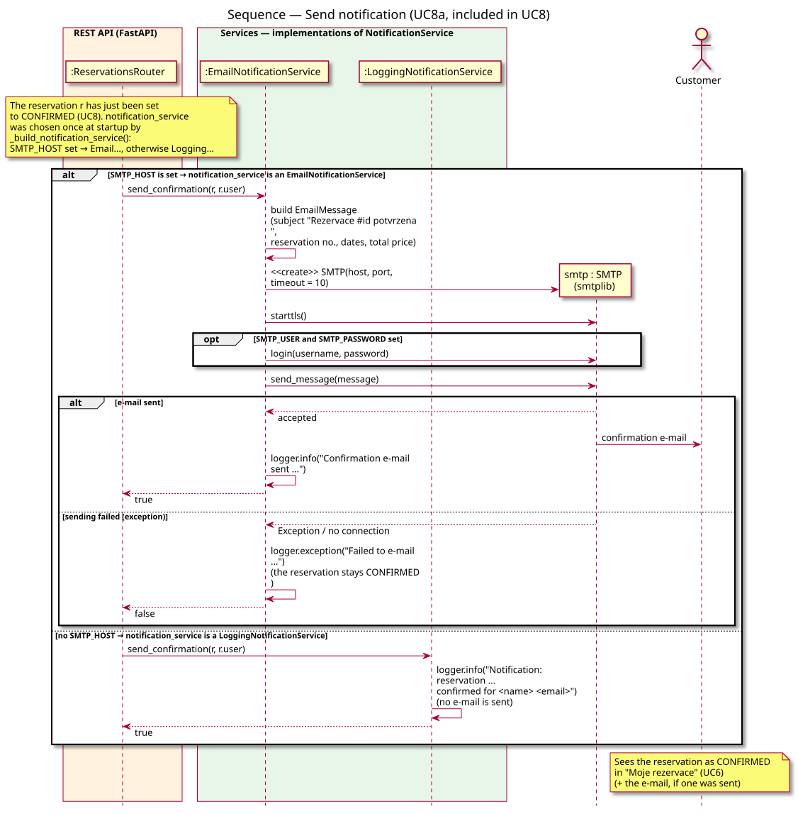

*Diagram source: [diagrams/sequence-send-notification.puml](diagrams/sequence-send-notification.puml).*

## UC9 — Manage fleet

Use case: [UC9 — Manage fleet](use-cases.md#uc9--manage-fleet--admin-only)

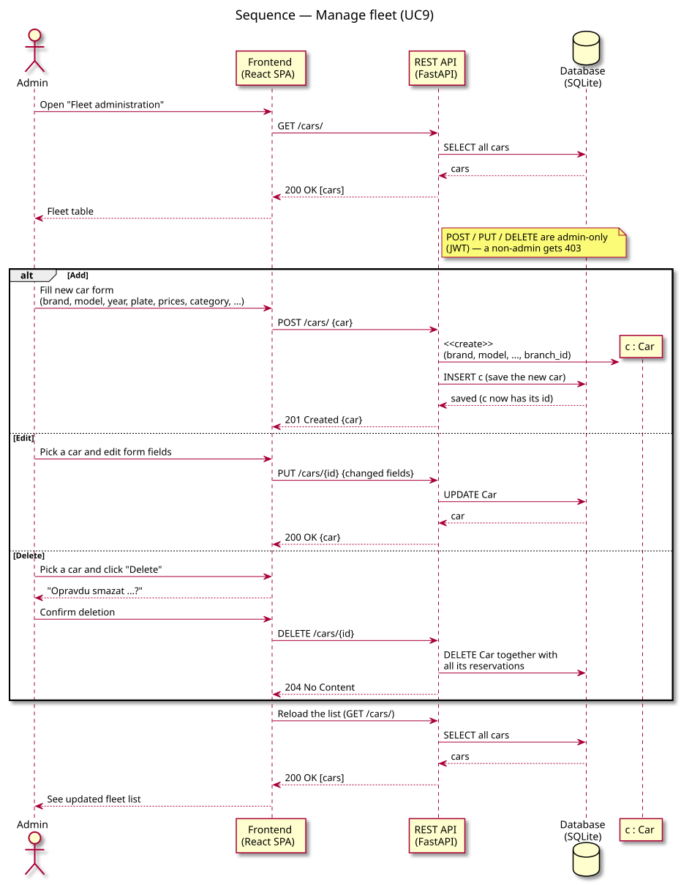

*Diagram source: [diagrams/sequence-manage-fleet.puml](diagrams/sequence-manage-fleet.puml).*

## UC10 — View all reservations

Use case: [UC10 — View all reservations](use-cases.md#uc10--view-all-reservations--admin-only)

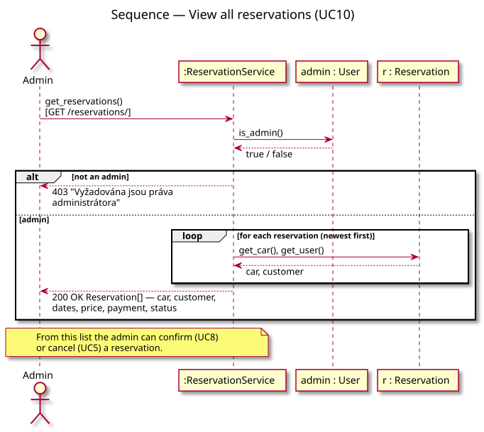

*Diagram source: [diagrams/sequence-view-all-reservations.puml](diagrams/sequence-view-all-reservations.puml).*
