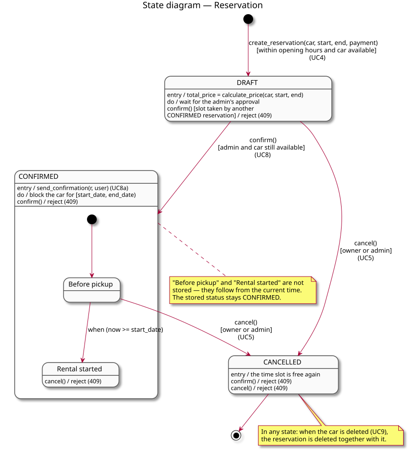
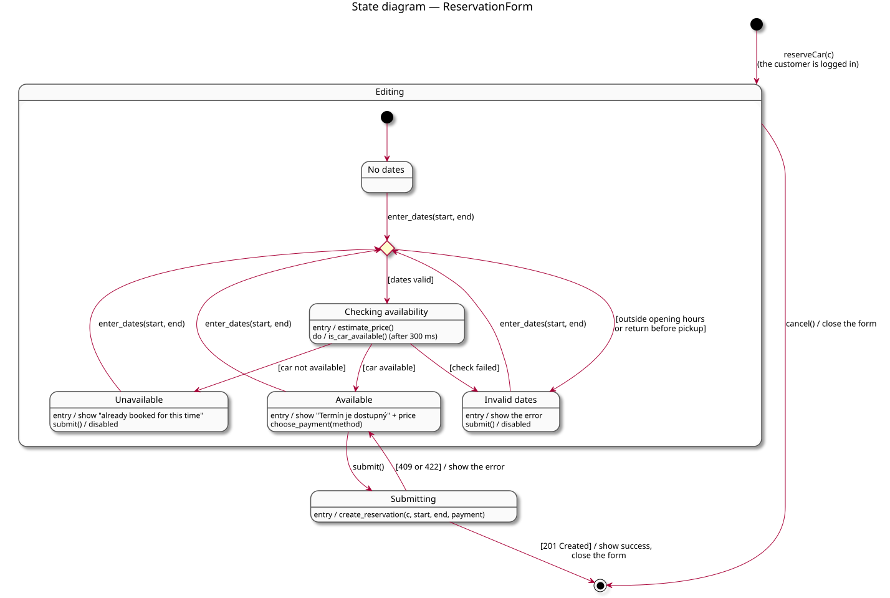

# State Diagrams

A state diagram describes the life cycle of **one class**: the states its
objects go through, the events (operations from the [sequence diagrams](sequence-diagrams.md))
that move them from one state to another, and the conditions (guards, in
`[...]`) under which a transition is allowed. It only makes sense for a class
whose behaviour really depends on its state — where the same operation
succeeds in one state and is refused in another.

Going through the classes of the [class diagram](class-diagram.md), that is true for two of
them: `Reservation` (its life cycle on the server) and `ReservationForm`
(what the customer can do while booking). The others are deliberately left
without a state diagram, because it would only have one or two trivial
states:

| Class | Why it has no state diagram |
|---|---|
| `AuthService`, `ReservationService`, `FleetService`, `NotificationService` | Stateless — they carry out operations on other objects but keep nothing of their own between two requests. |
| `User` | Its `role` (`CUSTOMER` / `ADMIN`) is fixed when the account is created and never changes in the system. |
| `Car`, `Branch` | They are only created, edited and deleted (UC9); every operation behaves the same for their whole lifetime. |
| `SupportWidget` | Only open / closed, with no rules attached. |

## State diagram — Reservation

*Diagram source: [diagrams/state-reservation.puml](diagrams/state-reservation.puml).*

**How to read it.** Each rounded box is a state of a reservation (the value
of its `status` field). An arrow is a transition, labelled
`event [guard]` and the use case it happens in; `entry / ...` is what
happens on entering the state, `do / ...` what holds while the reservation is
in it, and a line like `confirm() / reject (409)` inside a state is an event
that is **refused** in that state — the reservation stays where it is and the
API answers `409 Conflict`.

**The states and transitions** — each one is a step in one of the
[sequence diagrams](sequence-diagrams.md):

1. **→ `DRAFT`** — `create_reservation(...)` creates the reservation (UC4),
   but only within opening hours and only if no `CONFIRMED` reservation
   overlaps the slot (UC4a). The price is computed once, on entry, and never
   recomputed. A `DRAFT` reservation is only a request: it does **not** block
   the car, so several customers can hold a `DRAFT` for the same slot.
2. **`DRAFT` → `CONFIRMED`** — `confirm()` by an admin (UC8), only if the car
   is still free; otherwise the confirmation is refused with 409 and the
   reservation stays `DRAFT`. On entry the customer is notified (UC8a), and
   from now on the reservation blocks the car for its time slot.
3. **`DRAFT` → `CANCELLED`** and **`CONFIRMED` (before pickup) →
   `CANCELLED`** — `cancel()` by the owner or an admin (UC5). The time slot
   becomes free again.
4. **Inside `CONFIRMED`** the reservation moves on its own from *Before
   pickup* to *Rental started* when `start_date` passes. These two sub-states
   are not stored in the database — they follow from the current time — but
   they matter, because once the rental has started, `cancel()` is refused
   (the domain-specific rule of UC5).
5. **`CANCELLED`** is the final state: both `confirm()` and `cancel()` are
   refused there.

In any state, deleting the car (UC9) deletes its reservations together with
it.

## State diagram — ReservationForm

*Diagram source: [diagrams/state-reservation-form.puml](diagrams/state-reservation-form.puml).*

This is the booking form from the customer's side of UC4 — the same steps as
the `:ReservationForm` lifeline in the UC4 sequence diagram. While the
customer is filling it in, the form is in the composite state **`Editing`**;
every time the dates change (`enter_dates`), the diamond (a *choice*)
decides where it goes next:

1. **No dates** — the form has just opened.
2. **Invalid dates** — pickup or return is outside the opening hours
   (Mon–Fri 08:00–20:00) or the return is before the pickup; the error is
   shown and `submit()` is disabled. The form gets here also when the
   availability check itself fails.
3. **Checking availability** — the dates are valid, so the price estimate is
   computed straight away and, 300 ms after the last change, the form asks
   the server `is_car_available` (UC4a).
4. **Available** / **Unavailable** — the answer of the check. Only in
   *Available* can the customer choose the payment method and submit; in
   *Unavailable* the submit button is disabled.

**Submitting** sends `create_reservation` to the server. The server checks
everything again (opening hours, availability), so the request can still be
refused — then the error is shown and the form goes back to *Available*; on
`201 Created` the form shows the success message and closes. `cancel()`
closes the form from any of the editing states.

The two state diagrams fit together: a successful **Submitting** of the form
is exactly the transition **→ `DRAFT`** in the state diagram of
`Reservation`.
