# Use Cases

This document is the use case specification for CarRentalVSB: it defines,
for every piece of functionality a Customer or an Admin can use, who
triggers it, under what precondition, what the exact main and alternative
flows are (with the real API endpoint and HTTP status behind each one), and
what the system guarantees once it succeeds. It is the single source of
truth for *what the system does*, independent of how any particular screen
happens to be laid out.

## Use Case Diagram

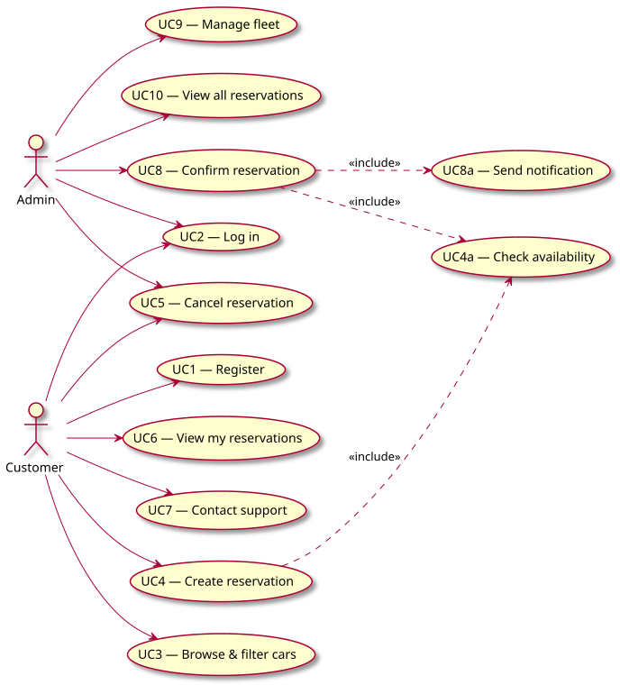

*Diagram source: [diagrams/use-case.puml](diagrams/use-case.puml) — PlantUML, the image is automatically re-rendered on every source change.*

### What this diagram specifies

The diagram above is the complete functional scope of CarRentalVSB as it is
actually implemented today: **2 actors** and **12 use cases**, covering
everything a customer or an admin can do in the system, from creating an
account to approving a reservation. It is read left to right: an actor
(stick figure) is connected to every use case (oval) it can trigger
directly; a dashed arrow labelled `<<include>>` means one use case always
triggers another as an internal step of its own flow, rather than an actor
triggering it directly.

**Customer** — anyone can browse the fleet and register without an account,
but everything else needs one. A customer can register (UC1), log in (UC2),
browse and filter the fleet (UC3), create (UC4) and cancel (UC5) their own
reservations, see their own reservation history (UC6), and reach support
(UC7).

**Admin** — shares the same login screen and endpoint as customers (UC2);
the account's `role` field is what unlocks the administration tabs on the
frontend, not a separate login. An admin additionally confirms pending
reservations (UC8), manages the fleet (UC9), sees every customer's
reservations (UC10), and — unlike a customer — can cancel *any* reservation
(UC5), not only their own.

Two use cases are never triggered by an actor directly; they only ever run
as a step **inside** another use case, which is exactly what the
`<<include>>` relationship means here:

- **UC4a — Check availability** runs inside UC4, twice (once live while the
  customer is still picking dates, once more right before the reservation
  is actually created), and inside UC8, once more, right before a
  reservation is confirmed.
- **UC8a — Send notification** runs inside UC8, immediately after a
  reservation becomes `CONFIRMED`.

Every use case on this diagram is implemented (✅) — there are no
planned/future use cases in the model. Multiple rental branches (F11) are
not a separate use case: they extend existing ones (a car's branch is shown
and filterable in UC3, and required when managing the fleet in UC9) — see
[requirements.md](requirements.md).

## Class Diagram

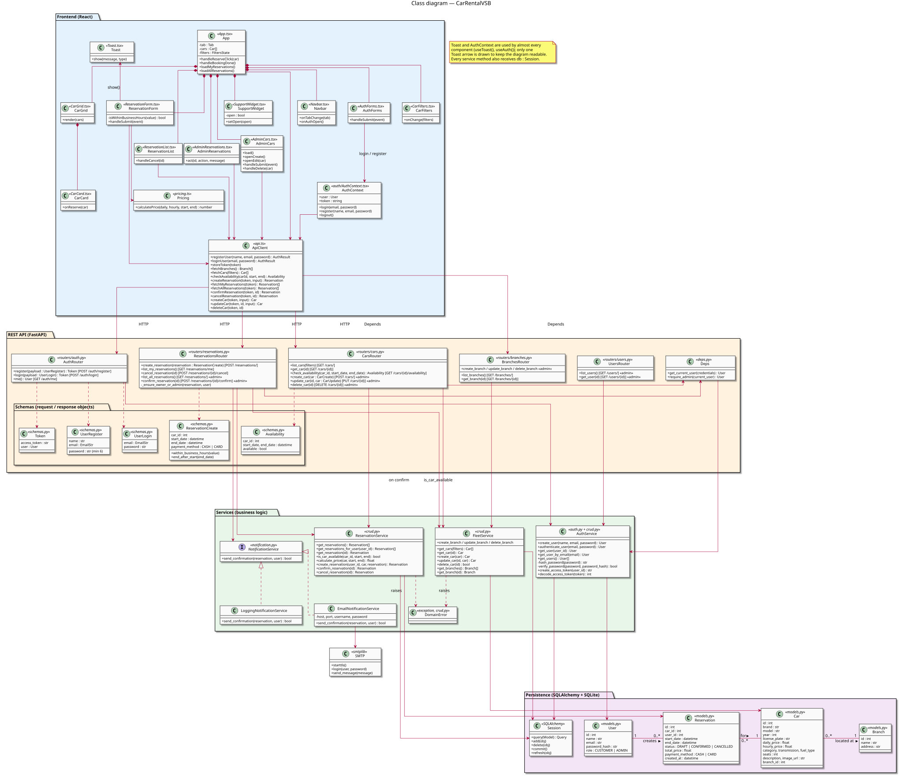

*Diagram source: [diagrams/class-system.puml](diagrams/class-system.puml) — PlantUML, the image is automatically re-rendered on every source change.*

### What this diagram specifies

The class diagram puts all the sequence diagrams below together into one
picture of the whole system. A sequence diagram shows *one* flow step by
step in time (e.g. "the admin confirms a reservation"); the class diagram
shows *every* participant of all those flows at once — what each part is
responsible for and which part calls which. It is deliberately simplified so
it stays readable: it shows the main parts and the main calls between them,
not every function in the code.

It is read **top to bottom, in four layers**, and arrows only ever point
downwards — a layer uses the one below it, never the other way round:

1. **Frontend (React)** — `ApiClient` (`api.ts`) is the single place the web
   app talks to the backend from. Every screen (car list, booking form, "My
   reservations", the admin pages) calls one of its methods; nothing else in
   the frontend sends requests.
2. **REST API** — three routers receive those HTTP requests, one per area:
   accounts (`AuthRouter`), reservations (`ReservationsRouter`) and the fleet
   — cars and branches (`CarsRouter`). Each box lists its real endpoints;
   `(admin)` marks the ones only an admin may call. A router only checks who
   is calling and what was sent, then passes the work on.
3. **Services** — the business logic itself:
   - `AuthService` — registering, logging in, hashing passwords and issuing
     the JWT token (UC1, UC2).
   - `ReservationService` — creating a reservation, the availability check
     (UC4a), the price calculation (F17), and confirming or cancelling
     (UC4, UC5, UC8).
   - `FleetService` — listing and filtering cars, and adding, editing and
     deleting cars and branches (UC3, UC9).
   - `NotificationService` — an **interface** (UC8a): `ReservationsRouter`
     calls it after a successful confirmation without knowing how the
     message is actually sent. The two dashed arrows show its two
     implementations — `LoggingNotificationService` (default, writes to the
     log) and `EmailNotificationService` (real e-mail, used once SMTP is
     configured).
4. **Domain model** — the four database tables and how they relate, read
   along the chain: a `User` **creates** 0..* `Reservation`s, each
   reservation is **for** exactly one `Car`, and each car is **located at**
   exactly one `Branch`. The allowed values of the important fields are
   written right next to them (a reservation is always `DRAFT`, `CONFIRMED`
   or `CANCELLED`; a user is a `CUSTOMER` or an `ADMIN`).

The small `<<…>>` label above each class name says which source file it
lives in. The backend is written in Python as modules of functions rather
than classes, so the three "Service" classes are logical groups of the
functions in `crud.py` and `auth.py` — e.g. everything about reservations in
`crud.py` is shown as `ReservationService`.

**Example — following one use case through the diagram (UC8, confirm a
reservation):** the admin's click goes through `ApiClient.confirmReservation`
→ `POST /reservations/{id}/confirm` in `ReservationsRouter` →
`ReservationService.confirm_reservation`, which re-checks availability and
changes the `Reservation`'s status to `CONFIRMED` → `ReservationsRouter`
then calls `NotificationService.send_confirmation`. The sequence diagram of
UC8 below shows exactly this path, step by step in time.

### How each use case is documented below

For every use case, this document gives three views of the same behaviour,
at increasing levels of technical detail:

1. **A table** — actor(s), precondition, the numbered main flow (with the
   real API endpoint each step calls), every alternative/error flow with
   its HTTP status code, and the result once the use case succeeds. This is
   the authoritative description; the two diagrams that follow are
   illustrations of it, not additional requirements.
2. **An activity diagram** — the same flow as a flowchart, with one
   swimlane per actor/component involved (`Customer`, `Admin`, `System`,
   ...). Every diagram has exactly one start node and one end node; every
   branch, including every error outcome, eventually merges back into a
   single final step before that end, so no alternative flow is a dead end.
3. **A sequence diagram** — the same flow as a left-to-right message
   exchange between the actor, the frontend (React SPA), the REST API
   (FastAPI), the database and, where relevant, the Notification Service —
   with the literal HTTP method, path and status code of every call, so it
   can be checked directly against the running API (see also
   [api-design.md](api-design.md)).

The activity diagram is the better starting point for explaining a flow to
a non-technical audience; the sequence diagram is the one to open when
discussing the actual implementation or writing a test for it.

## UC1 — Register ✅

| | |
|---|---|
| Actor | Customer |
| Precondition | — |
| Main flow | 1. The customer opens the account modal and picks "Create account". 2. Enters name, e-mail and password (`POST /auth/register`). 3. The system hashes the password (bcrypt), creates the `User` (role `CUSTOMER`) and issues a JWT access token. |
| Alternative flow A1 | The e-mail is already registered → error 409. |
| Result | A new `User` exists; the customer is logged in. |

### Activity diagram — Register

The diagram reduces the whole use case to one decision the System makes
right after the form is submitted: is the e-mail already taken? The `no`
branch is the common path — hashing the password, creating the account and
issuing a token all happen before control returns to the customer; the
`yes` branch only ever produces an error. Both branches converge on the
same final "see result" step, so the customer always gets one unambiguous
outcome regardless of which path was taken.

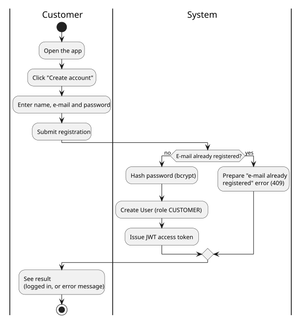

*Diagram source: [diagrams/activity-register.puml](diagrams/activity-register.puml).*

### Sequence diagram — Register

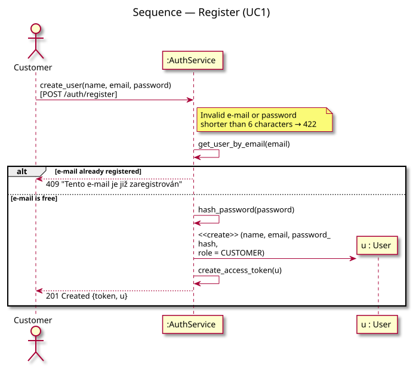

*Diagram source: [diagrams/sequence-register.puml](diagrams/sequence-register.puml).*

## UC2 — Log in ✅

| | |
|---|---|
| Actors | Customer, Admin |
| Precondition | The user already has an account (UC1, or seeded — e.g. the demo admin). |
| Main flow | 1. The user enters e-mail and password (`POST /auth/login`). 2. The system verifies the password hash and issues a JWT access token. |
| Alternative flow A1 | Wrong e-mail or password → error 401. |
| Result | The user is logged in; the frontend stores the token and shows role-appropriate tabs (Admin sees the administration tabs). |

### Activity diagram — Log in

Structurally this mirrors registration, but with a single check instead of
two possible causes of failure: does the submitted e-mail/password pair
match an existing account? Only the System swimlane branches — the
customer's own steps (enter credentials, submit) are identical regardless
of the outcome — and both branches converge on the same final step before
the diagram ends.

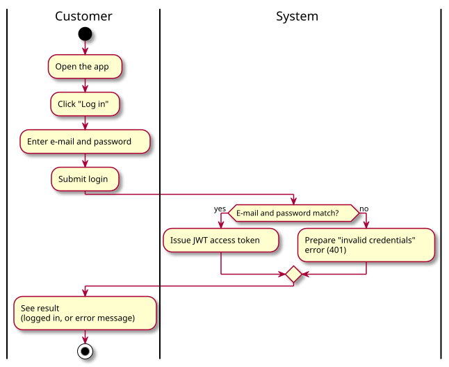

*Diagram source: [diagrams/activity-login.puml](diagrams/activity-login.puml).*

### Sequence diagram — Log in

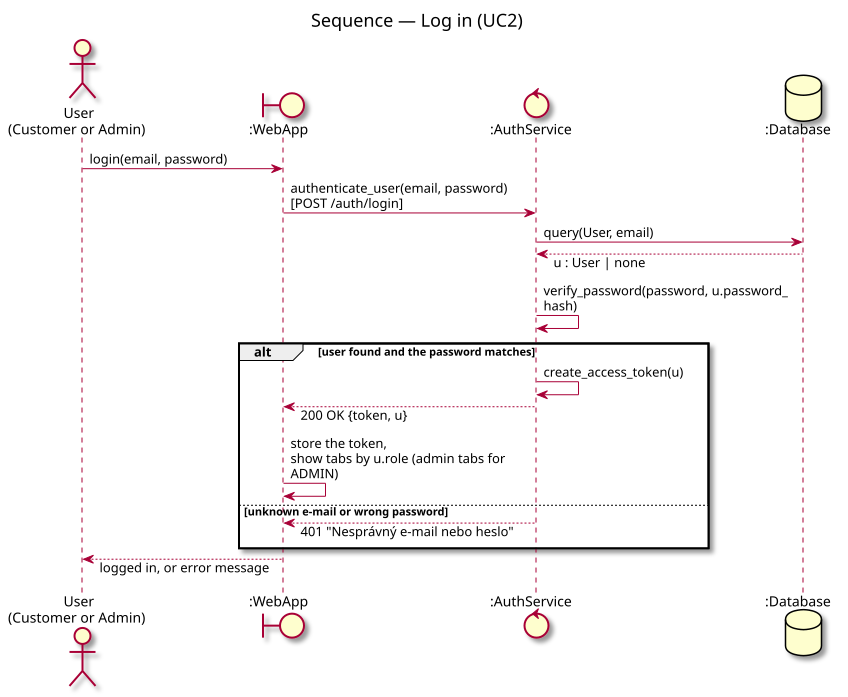

*Diagram source: [diagrams/sequence-login.puml](diagrams/sequence-login.puml).*

## UC3 — Browse & filter cars ✅

| | |
|---|---|
| Actor | Customer (no login required) |
| Precondition | — |
| Main flow | 1. The customer opens the app. 2. The system lists all cars (`GET /cars/`). 3. The customer optionally sets filters (category, transmission, fuel type, price range, branch — F11); the system re-queries and returns the matching cars. |
| Alternative flow | The fleet (or the filtered result) is empty → the system shows an informational message. |
| Result | The customer sees a grid of cars matching the current filters, each with a photo (or category illustration), specs, branch, and both the hourly and daily price. |

### Activity diagram — Browse & filter cars

The System always returns the complete, unfiltered fleet first, so the
customer never faces an empty screen while deciding whether to filter at
all; the single `if` in the System swimlane only runs once a filter is
actively chosen, and its result simply replaces the car grid already on
screen rather than starting a new flow.

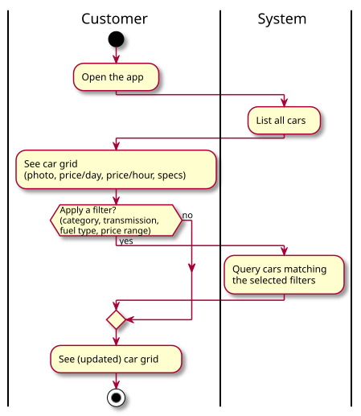

*Diagram source: [diagrams/activity-browse-cars.puml](diagrams/activity-browse-cars.puml).*

### Sequence diagram — Browse & filter cars

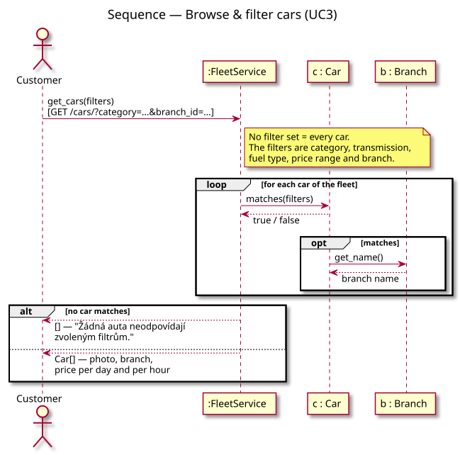

*Diagram source: [diagrams/sequence-browse-cars.puml](diagrams/sequence-browse-cars.puml).*

## UC4 — Create reservation ✅

| | |
|---|---|
| Actor | Customer |
| Precondition | The customer is logged in (UC2) and the chosen car exists (UC3). |
| Main flow | 1. The customer picks a car and clicks "Reserve" (a logged-out visitor is asked to log in or register first, then the booking form opens). 2. Enters pickup and return date & time. 3. The system runs UC4a while the form is being filled (checks availability against `CONFIRMED` reservations). 4. The customer chooses a payment method (Cash, or Card with a mock card-details step that never leaves the browser). 5. On submit, the system runs UC4a again, computes `total_price` (daily rate per full 24h block, remaining hours at the hourly rate capped at one more day) and creates the reservation in `DRAFT` state with the chosen `payment_method`. |
| Alternative flow A1 | Pickup or return falls outside opening hours (Mon–Fri, 08:00–20:00) → blocked client-side before submission is even possible; the API also rejects it server-side (422) if it's ever submitted anyway. |
| Alternative flow A2 | The date range conflicts with a **confirmed** reservation → the form shows it and submitting is disabled; if the slot gets confirmed between that check and the submit, the system returns error 409. |
| Alternative flow A3 | `end_date` <= `start_date` → blocked in the form; the API returns validation error 422. |
| Result | A new reservation exists in `DRAFT` state, linked to the car, the logged-in customer, the chosen dates, the computed price and the payment method — awaiting UC8 (admin approval). |

### Activity diagram — Create reservation

This is the most involved flow in the system: it nests three independent
decisions — is the customer logged in, do the chosen dates satisfy the
opening-hours/return-after-pickup rule, and is the car available — and the
availability check (UC4a) deliberately runs *twice*: once live while the
dates are being picked, purely to inform the customer, and once more,
authoritatively, the instant the reservation is submitted, because the
first result can go stale while the customer is still choosing a payment
method. Every branch, including both distinct "slot taken" outcomes, still
merges into the same single final "see result" step.

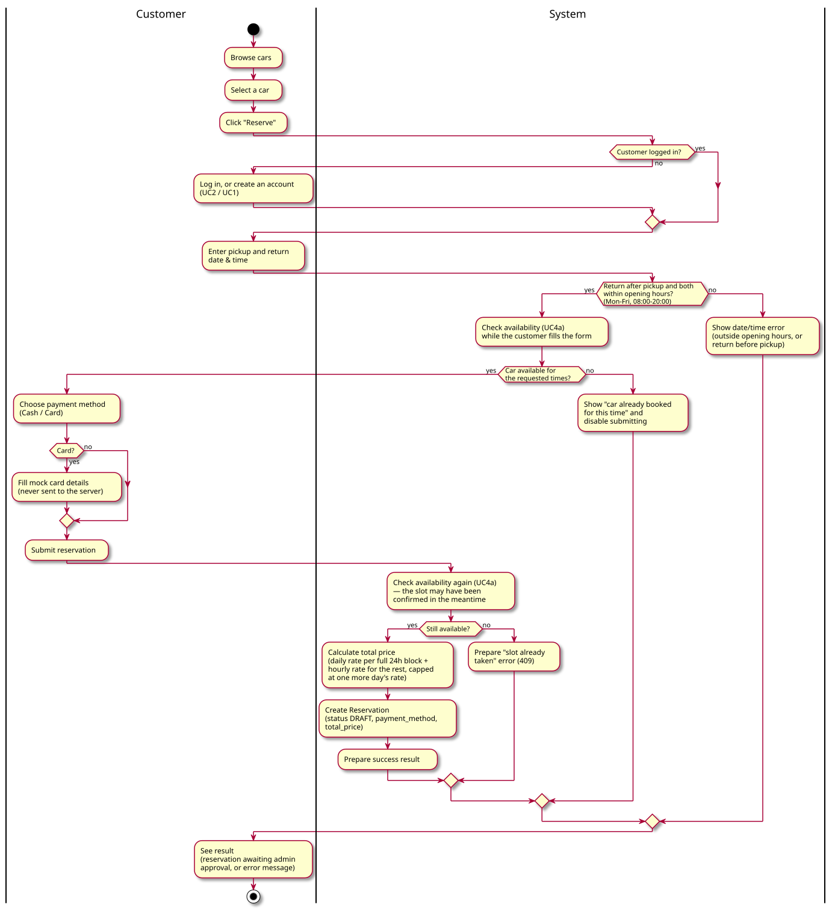

*Diagram source: [diagrams/activity-make-reservation.puml](diagrams/activity-make-reservation.puml).*

### Sequence diagram — Create reservation

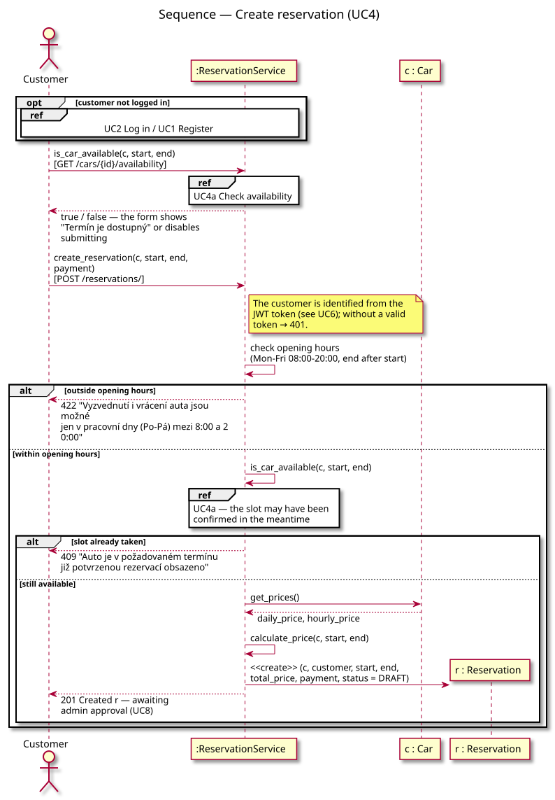

*Diagram source: [diagrams/sequence-make-reservation.puml](diagrams/sequence-make-reservation.puml).*

## UC4a — Check availability ✅ (include, part of UC4 and UC8)

| | |
|---|---|
| Actor | System |
| Main flow | The system compares the requested date range against all `CONFIRMED` reservations for that car; if no interval overlaps, the car is available. Enforced in `crud.is_car_available`. |

### Activity diagram — Check availability

Because this use case is only ever triggered by another one (UC4 or UC8),
its first swimlane belongs to the *caller* ("Customer / Admin") rather than
to an actor acting on its own — and the System lane reduces to a single
comparison: does any `CONFIRMED` reservation for this car overlap the
requested date range? `DRAFT` and `CANCELLED` reservations are deliberately
excluded from the check, since neither of them actually blocks the slot.

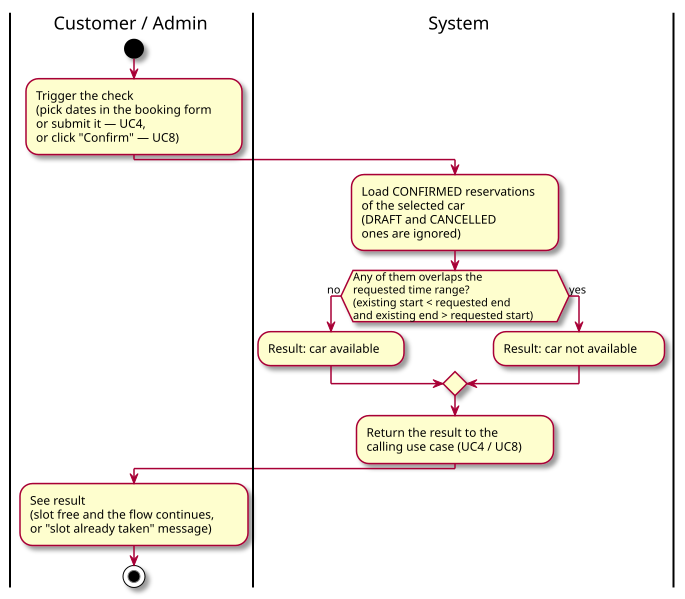

*Diagram source: [diagrams/activity-check-availability.puml](diagrams/activity-check-availability.puml).*

### Sequence diagram — Check availability

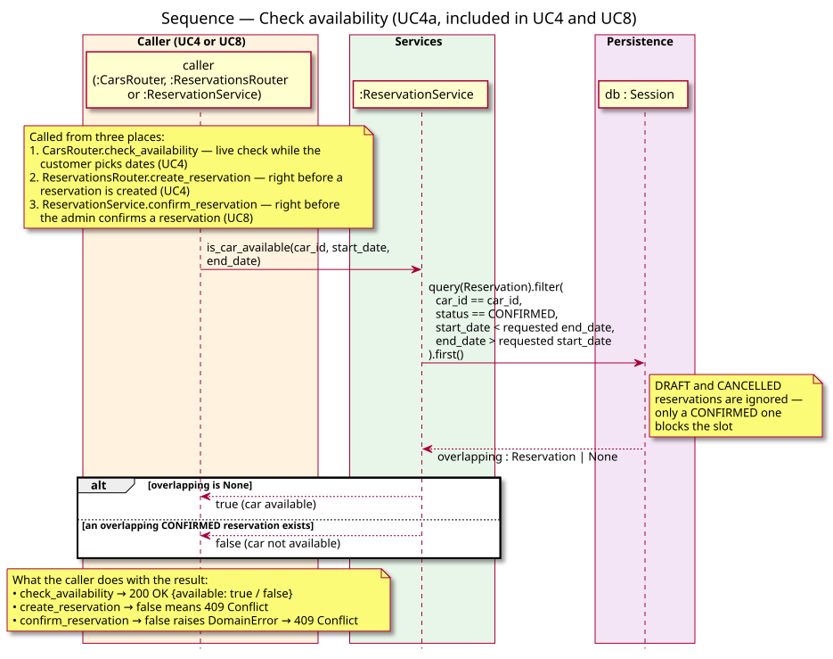

*Diagram source: [diagrams/sequence-check-availability.puml](diagrams/sequence-check-availability.puml).*

## UC5 — Cancel reservation ✅

| | |
|---|---|
| Actors | Customer (own reservations), Admin (any reservation) |
| Precondition | The reservation exists and isn't already `CANCELLED`. |
| Main flow | 1. The user clicks "Cancel" (`POST /reservations/{id}/cancel`). 2. The system sets the state to `CANCELLED`. |
| Alternative flow A1 | The reservation is already `CANCELLED` → error 409. |
| Alternative flow A2 (domain-specific rule) | The reservation is `CONFIRMED` and `start_date` has already passed → error 409, an ongoing rental can't be cancelled. |
| Alternative flow A3 | A customer tries to cancel someone else's reservation → error 403 (owner-or-admin check). |
| Result | The reservation is `CANCELLED`; the slot is free again for another confirmation. |

### Activity diagram — Cancel reservation

Three independent guard clauses have to pass, in a fixed order, before a
cancellation succeeds — ownership (or admin), not already `CANCELLED`, and
not a `CONFIRMED` rental whose period has already started — so the diagram
reads top to bottom as exactly the sequence `crud.cancel_reservation`
evaluates them in. Any single failing check produces its own distinct error
and short-circuits the rest.

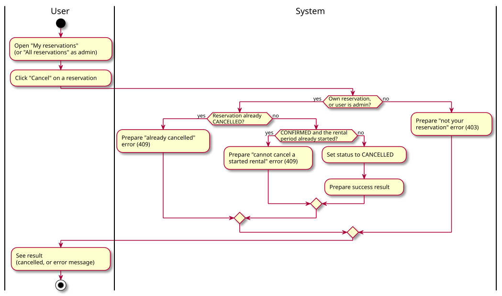

*Diagram source: [diagrams/activity-cancel-reservation.puml](diagrams/activity-cancel-reservation.puml).*

### Sequence diagram — Cancel reservation

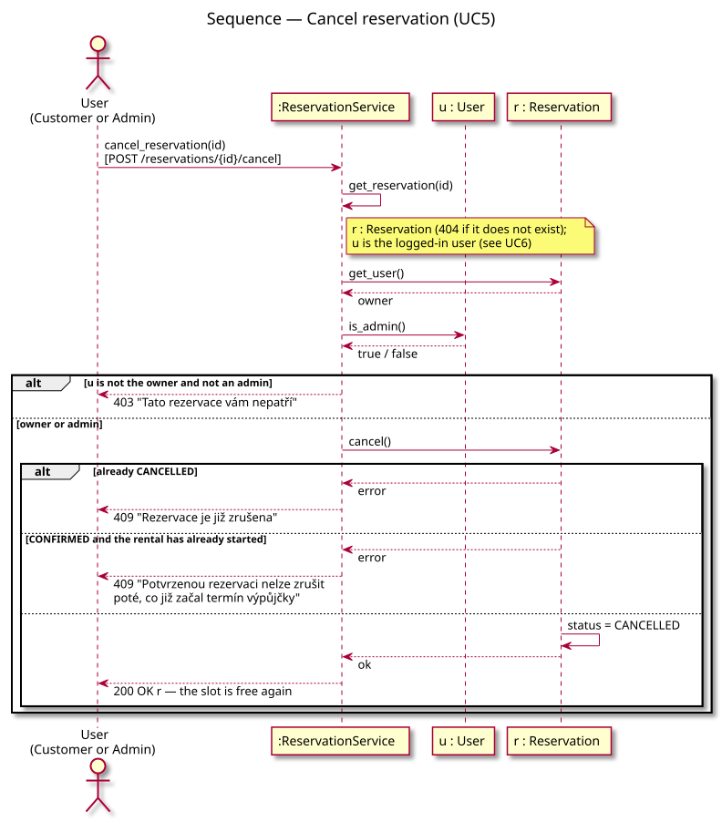

*Diagram source: [diagrams/sequence-cancel-reservation.puml](diagrams/sequence-cancel-reservation.puml).*

## UC6 — View my reservations ✅

| | |
|---|---|
| Actor | Customer |
| Precondition | The customer is logged in. |
| Main flow | 1. The customer opens "My reservations" (`GET /reservations/me`). 2. The system returns only that customer's reservations. 3. The customer sees each one with a car thumbnail, dates, price, payment method and status. |
| Result | The customer has an overview of their own reservations and can cancel any of them (UC5). |

### Activity diagram — View my reservations

The simplest flow in the system: one request, one response, no branching —
the System always returns exactly the logged-in customer's own
reservations and nothing else. That single difference (whose reservations
are returned) is also what distinguishes this use case from its
admin-only counterpart, UC10.

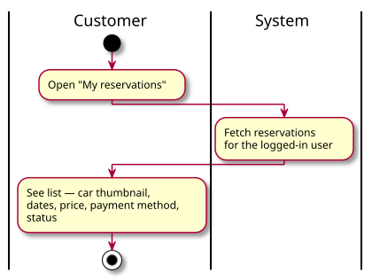

*Diagram source: [diagrams/activity-view-my-reservations.puml](diagrams/activity-view-my-reservations.puml).*

### Sequence diagram — View my reservations

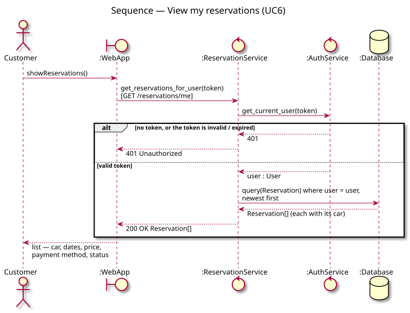

*Diagram source: [diagrams/sequence-view-my-reservations.puml](diagrams/sequence-view-my-reservations.puml).*

## UC7 — Contact support ✅

| | |
|---|---|
| Actor | Customer |
| Precondition | — |
| Main flow | 1. The customer clicks the floating support button (visible on every page). 2. The system shows a panel with a dummy phone number, e-mail and office hours. 3. Clicking either opens the device's phone/mail app. |
| Result | The customer has a way to reach support, purely client-side (no backend call). |

### Activity diagram — Contact support

Everything here happens in the browser; the System swimlane exists only to
show that showing the contact panel and opening the phone/mail app are
handled by the frontend itself — there is no call to the backend anywhere
in this flow. The single `if` is optional: closing the panel without
clicking a contact method is just as valid an ending as using one.

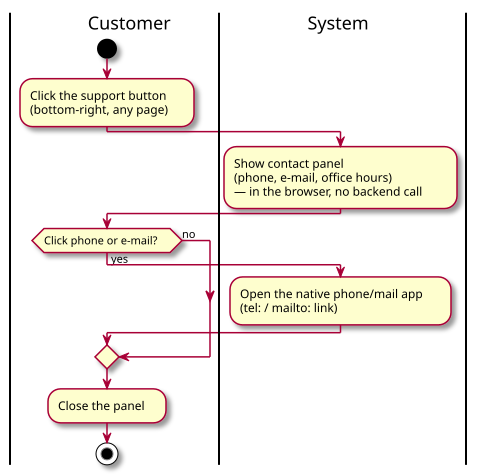

*Diagram source: [diagrams/activity-contact-support.puml](diagrams/activity-contact-support.puml).*

### Sequence diagram — Contact support

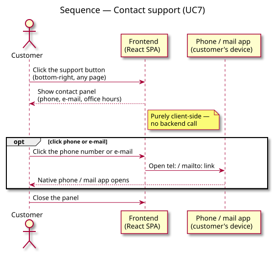

*Diagram source: [diagrams/sequence-contact-support.puml](diagrams/sequence-contact-support.puml).*

## UC8 — Confirm reservation ✅ (admin-only)

| | |
|---|---|
| Actor | Admin |
| Precondition | The reservation exists in `DRAFT` state (UC4). The customer **cannot** confirm their own reservation — this is a deliberate domain rule: a request only becomes binding once staff has approved it. |
| Main flow | 1. The admin opens "All reservations" and clicks "Confirm" on a pending one (`POST /reservations/{id}/confirm`). 2. The system re-runs UC4a against the other `CONFIRMED` reservations. 3. If the slot is still free, the state changes to `CONFIRMED` and the system runs UC8a (sends a confirmation notification). |
| Alternative flow A1 | The reservation isn't in `DRAFT` state anymore → error 409. |
| Alternative flow A2 | Another reservation for an overlapping date range was confirmed in the meantime → error 409, which upholds the common business rule. |
| Alternative flow A3 | A non-admin tries to confirm → error 403. |
| Result | The reservation is `CONFIRMED`; the customer has received a notification. |

### Activity diagram — Confirm reservation

Confirmation uses the same guard-clause style as cancellation: is the
reservation still `DRAFT`, then is the car still available. What makes this
flow different is that its success branch doesn't end once the status
flips to `CONFIRMED` — it continues straight into UC8a (send the
notification) before control returns to the admin, because notifying the
customer is part of what "confirming" means in this system, not a
side effect bolted on afterwards.

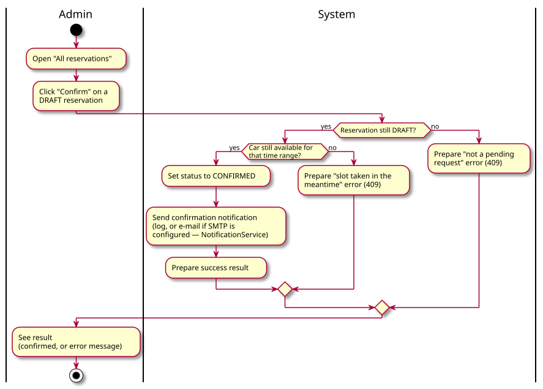

*Diagram source: [diagrams/activity-confirm-reservation.puml](diagrams/activity-confirm-reservation.puml).*

### Sequence diagram — Confirm reservation

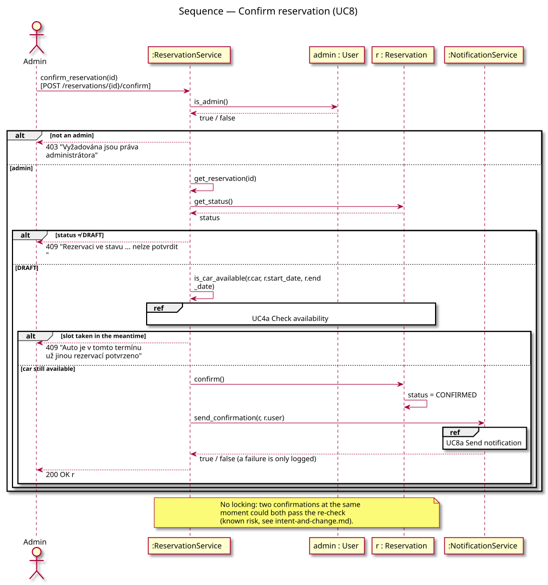

*Diagram source: [diagrams/sequence-confirm-reservation.puml](diagrams/sequence-confirm-reservation.puml).*

## UC8a — Send notification ✅ (include, part of UC8, external boundary)

| | |
|---|---|
| Actor | Notification Service (external boundary) |
| Main flow | After confirming a reservation, the system calls `NotificationService.send_confirmation`. By default `LoggingNotificationService` logs it; if SMTP environment variables are set, `EmailNotificationService` sends a real e-mail instead — same interface, no domain code changes. If sending the e-mail fails, the error is only logged and the reservation stays `CONFIRMED`. |

### Activity diagram — Send notification

This is the only diagram in the system with three swimlanes instead of two,
because there are genuinely three independent parties involved: the System
that decides *whether* to attempt an e-mail at all, the Notification
Service that attempts it and decides whether it *succeeded*, and the
Customer who only materially benefits from the one branch where it did.
A failed send is deliberately swallowed — logged, not surfaced — so the
reservation the admin just confirmed is never rolled back because of an
e-mail problem.

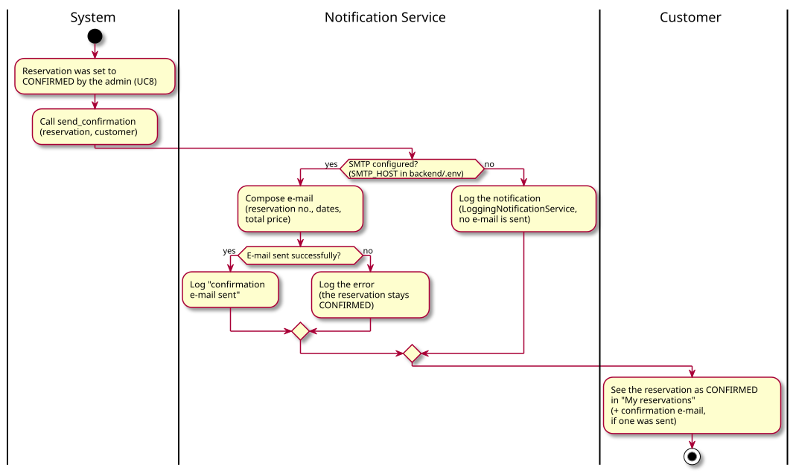

*Diagram source: [diagrams/activity-send-notification.puml](diagrams/activity-send-notification.puml).*

### Sequence diagram — Send notification

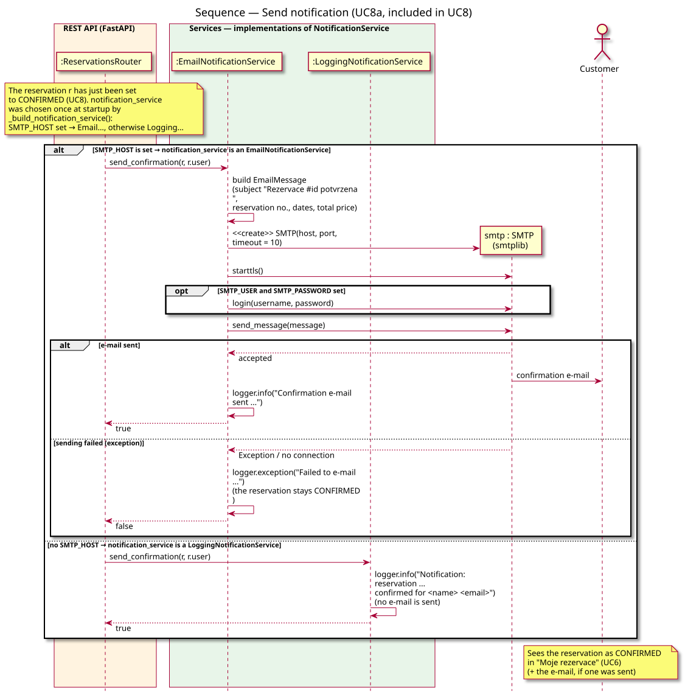

*Diagram source: [diagrams/sequence-send-notification.puml](diagrams/sequence-send-notification.puml).*

## UC9 — Manage fleet ✅ (admin-only)

| | |
|---|---|
| Actor | Admin |
| Precondition | The admin is logged in. |
| Main flow | The admin adds (`POST /cars/`), edits (`PUT /cars/{id}`) or removes (`DELETE /cars/{id}`) a car in the fleet, including its category, transmission, fuel type, seats, prices, description, photo URL and branch (F11, required — every car belongs to exactly one). Removing a car also deletes all of its reservations. |
| Alternative flow A1 | A non-admin calls any of these endpoints → error 403. |
| Alternative flow A2 | `branch_id` doesn't reference an existing branch → error 404. |
| Result | The fleet list reflects the change immediately for all customers. |

### Activity diagram — Manage fleet

A single three-way `switch` replaces three separate flows for add / edit /
delete, since all three share the same shape in both swimlanes: the admin
fills in or confirms something, the System persists it, and the fleet list
is refreshed. Deleting is the only branch with a consequence that reaches
outside the fleet itself — every reservation for that car is removed along
with it — which is why that step is called out explicitly rather than left
as a plain "Delete Car".

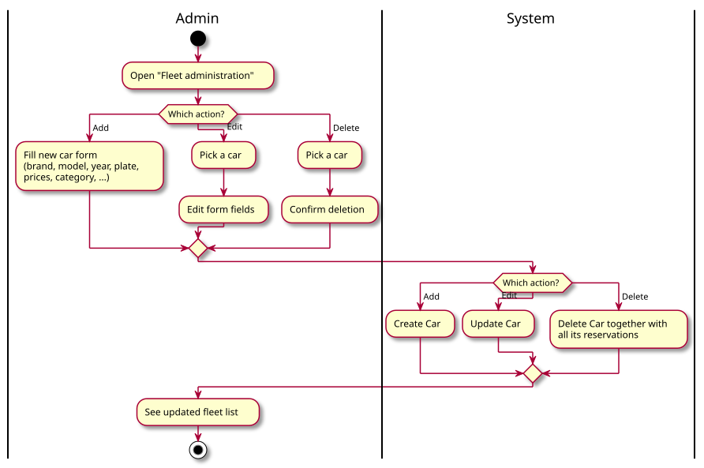

*Diagram source: [diagrams/activity-manage-fleet.puml](diagrams/activity-manage-fleet.puml).*

### Sequence diagram — Manage fleet

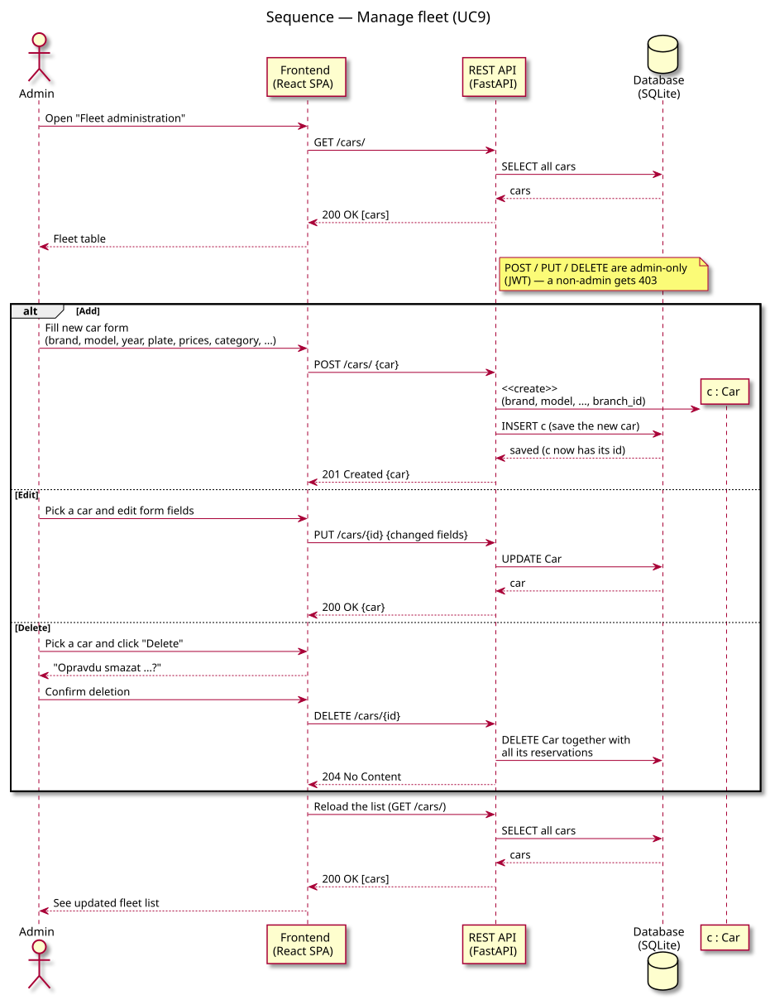

*Diagram source: [diagrams/sequence-manage-fleet.puml](diagrams/sequence-manage-fleet.puml).*

## UC10 — View all reservations ✅ (admin-only)

| | |
|---|---|
| Actor | Admin |
| Precondition | The admin is logged in. |
| Main flow | The admin opens "All reservations" (`GET /reservations/`) and sees every reservation from every customer, with contact info, dates, price, payment method and status — the entry point for UC8 (confirm) and UC5 (cancel). |
| Alternative flow A1 | A non-admin calls this endpoint → error 403. |
| Result | The admin has a full overview of demand across the fleet. |

### Activity diagram — View all reservations

Like UC6, this is a single request/response with no branching at all — the
difference is scope, not shape: every customer's reservations instead of
just the logged-in user's own. It is the admin-only entry point that feeds
both UC8 (confirm a pending one) and UC5 (cancel any one of them).

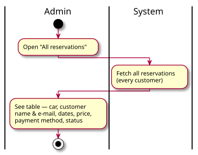

*Diagram source: [diagrams/activity-view-all-reservations.puml](diagrams/activity-view-all-reservations.puml).*

### Sequence diagram — View all reservations

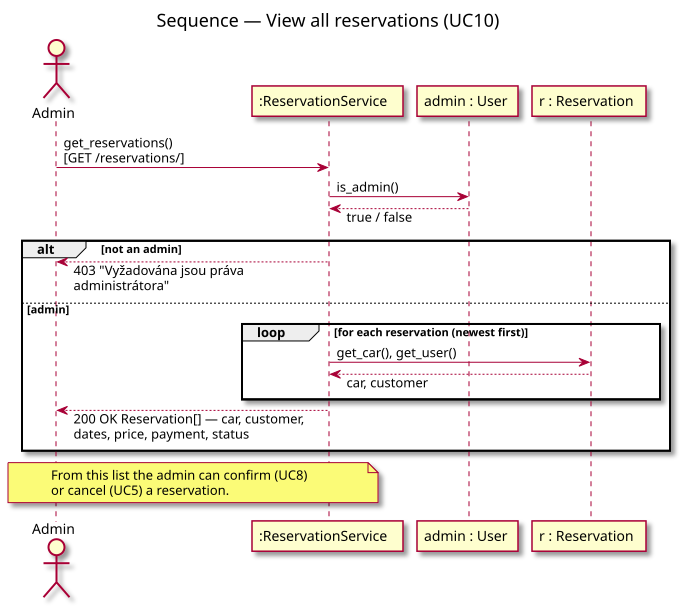

*Diagram source: [diagrams/sequence-view-all-reservations.puml](diagrams/sequence-view-all-reservations.puml).*
